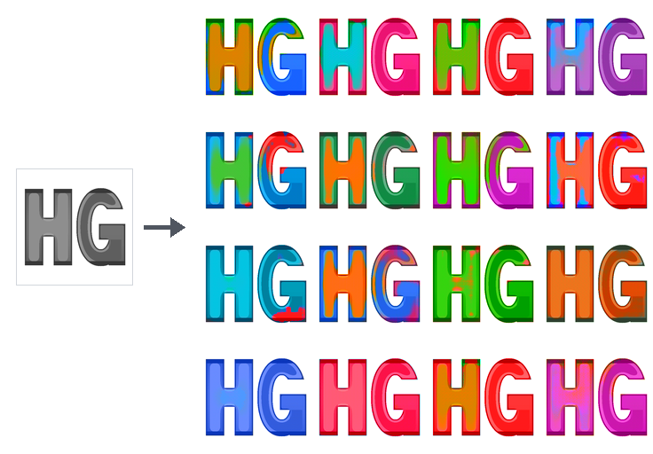

#  HyperGAN

<p>by <a href="https://255labs.xyz"><picture>
  <source media="(prefers-color-scheme: dark)" srcset="https://raw.githubusercontent.com/HyperGAN/HyperGAN/master/docs/assets/255labs-lockup.svg" />
  
</picture></a></p>

**Train generative models. Follow their progress. Export the result.**

[](https://pypi.org/project/hypergan/)
[](https://pypi.org/project/hypergan/)
[](https://github.com/HyperGAN/HyperGAN/blob/master/LICENSE)
[](https://github.com/HyperGAN/HyperGAN/actions/workflows/ci.yml)
[](https://hypergan.github.io/HyperGAN/)

[Documentation](https://hypergan.github.io/HyperGAN/) · [Quickstart](https://hypergan.github.io/HyperGAN/quickstart/) · [Examples](https://hypergan.github.io/HyperGAN/examples/) · [Python API](https://hypergan.github.io/HyperGAN/reference/api/) · [CLI Reference](https://hypergan.github.io/HyperGAN/reference/cli/) · [TOML Schema](https://hypergan.github.io/HyperGAN/reference/schema/) · [HNDL Ops](https://hypergan.github.io/HyperGAN/reference/ops/)

---

HyperGAN 2.1.1 trains generative models from declarative `hypergan-model/1` TOML recipes using [HNDL](https://hypergan.github.io/HyperGAN/reference/ops/) neural graphs and [ParticleGAN](https://github.com/HyperGAN/HyperGAN/blob/master/docs/particlegan.md) (`unified_v11`, multi-critic coupled thermal coordination). Drive every workflow from the Docker-style CLI or lazy-loaded typed Python API (`import hypergan as hg`, 129 public symbols), watch training live in the Foldlite DB WebAssembly Observatory, and export standalone EMA generators for serving.



*The HyperGAN icon above is generated by conditioning the packaged [128×128 HNDL particle colorizer](https://github.com/HyperGAN/HyperGAN/blob/master/docs/colorization.md) on a grayscale **HG** monogram across 16 particle draws with exact 7-face polytope luminance lock. View the [single badge](https://raw.githubusercontent.com/HyperGAN/HyperGAN/master/docs/assets/hypergan-logo.png), [colorized grid](https://raw.githubusercontent.com/HyperGAN/HyperGAN/master/docs/assets/hypergan-logo-grid.png), and [grayscale source](https://raw.githubusercontent.com/HyperGAN/HyperGAN/master/docs/assets/hg-bw-128.png).*

### What HyperGAN Ships & Measured Highlights

| Area | Verified Result / Capability | Reference |
| :--- | :--- | :--- |
| **5 Packaged Wheel Recipes** | `gaussian-grid`, `image-folder-128`, `colorization-128`, `cifar10-tiny-transformer`, and `cifar10-transgan` ship inside the wheel (`hypergan recipes`), plus a 256×256 DINOv3 colorizer source example | [Examples Gallery](https://hypergan.github.io/HyperGAN/examples/) |
| **256×256 DINOv3 Colorization** | Held-out **FID-10k `6.37`** at step 2,500 on 2× RTX A6000 (ParticleGAN 0.9.7 BISPF); grayscale luminance error `2.61e-7` | [Colorization setup](https://github.com/HyperGAN/HyperGAN/blob/master/docs/colorization.md) |
| **CIFAR-10 32×32 Benchmarks** | `cifar10-tiny-transformer`: **FID-50k `14.56`** @ 15k steps (BISPF) · **`15.16`** @ 12.5k steps (EMPF, `3.32 steps/s`) on 2× RTX A6000, global batch 256 | [CIFAR recipes & results](https://github.com/HyperGAN/HyperGAN/blob/master/docs/cifar-recipe.md) |
| **Multi-GPU NCCL Scaling** | **2.20×** single-GPU throughput (`1,517.19 img/s`, 110.2% efficiency) on 2× RTX A6000 at global batch 256 (`0.79×` at batch 64) | [Scaling measurements](https://github.com/HyperGAN/HyperGAN/blob/master/docs/scaling-benchmark.md) |
| **4 Standalone Export Formats** | Privacy-clean EMA generator exports to Python `bundle` (`.pt`), PyTorch `pt2`, `onnx`, and `safetensors` | [Deployment guide](https://github.com/HyperGAN/HyperGAN/blob/master/docs/deployment.md) |

---

## Install

Use Python 3.12+ for the tested training runtime. Lightweight package checks cover Python 3.11–3.14 on Linux, macOS and Windows; the CPU reference profile is tested on Linux. The `train` extra accepts `torch>=2.6,<3`, but CI tests only `torch==2.14.0`, the version the commands below install; other versions are untested.

### From PyPI (Recommended)

**CPU:**

```sh
python -m venv .venv
. .venv/bin/activate
python -m pip install "torch==2.14.0" "torchvision==0.29.0" --index-url https://download.pytorch.org/whl/cpu
python -m pip install "hypergan[all]==2.1.1"
hypergan --help
python -m hypergan --version
```

**NVIDIA GPU (CUDA 13.0):**

```sh
python -m pip install "torch==2.14.0" "torchvision==0.29.0" --index-url https://download.pytorch.org/whl/cu130
python -m pip install "hypergan[all]==2.1.1"
```

### From a Source Checkout

```sh
git clone https://github.com/HyperGAN/HyperGAN.git
cd HyperGAN
python -m venv .venv
. .venv/bin/activate
python -m pip install -e .
hypergan --help
python -m hypergan --version
```

For local NVIDIA GPU training from source:

```sh
python -m pip install "torch==2.14.0" "torchvision==0.29.0" --index-url https://download.pytorch.org/whl/cu130
python -m pip install -e ".[all]"
```

For a local CPU correctness fixture from source, install the CPU PyTorch wheel instead (`python -m pip install "torch==2.14.0" "torchvision==0.29.0" --index-url https://download.pytorch.org/whl/cpu`) before `python -m pip install -e ".[all]"` and pass `--device cpu` (or `-d cpu`). Lightweight CLI commands (`new`, `validate`, `ps`, `status`, `logs`, `inspect`, `tag`, `runs`, `queue`, `gc`, `rm`) do not import PyTorch or ParticleGAN.

---

## 60-Second Quickstart

The core install can scaffold and validate `gaussian-grid`. For image templates using `defaults = "particlegan"`, install the `train` extra (included in `all`) so structural validation can read the installed ParticleGAN preset.

Explore starter templates (`dcgan`, `tiny-transformer`, `resnet`, `gaussian-grid`) and packaged wheel recipes:

```sh
hypergan new --list
hypergan recipes
```

Scaffold a project workspace (`hypergan.toml`, `runs/`, and `configs/<template>.toml`). When `--dataset` points at an image folder, `hypergan new` inspects image headers without loading pixels into RAM, auto-detects the resolution (`32`, `64`, `128`, or `256`) and color mode (`RGB` or `L`), and sizes the HNDL generator and critic automatically:

```sh
# Image GAN project sized automatically from a folder of images
hypergan new --project my_gan --dataset ./images

# Or specify an explicit template and resolution (or 2D toy fixture on CPU)
hypergan new --project my_transformer --template tiny-transformer --resolution 64
hypergan new --project my_toy --template gaussian-grid --device cpu
```

Validate the generated `format = "hypergan-model/1"` configuration before launching training:

```sh
# Fast structural validation (no Torch imports)
hypergan validate my_gan/configs/dcgan.toml
hypergan validate my_gan

# Validate with inline overrides and emit resolved JSON
hypergan validate my_gan/configs/dcgan.toml -s train.batch_size=32 -s optimizer.lr=0.0002 --json

# Verify image dataset inventory/hashes (--data) and construct networks in a worker (--runtime)
hypergan validate my_gan/configs/dcgan.toml --data
hypergan validate my_gan/configs/dcgan.toml --runtime
```

---

## CLI Tour

Full flags and subcommands are documented in the [CLI Reference](https://hypergan.github.io/HyperGAN/reference/cli/).

### Training & Docker-Style Live Run Management

Start training from a model `.toml` file or packaged recipe name. Customize the run name (`-n`), override any config key (`-s KEY=VALUE`), or pick the device (`-d`):

```sh
hypergan train my_gan/configs/dcgan.toml --steps 1000
hypergan train my_gan/configs/dcgan.toml -n exp-lr2e4 -s train.lr=0.0002 -s train.batch_size=32
hypergan train my_toy/configs/gaussian-grid.toml --steps 20 -d cpu --no-server
```

Every run is tracked in a daemonless global registry with a unique **Run ID** (`<short_id>`, e.g. `0608d849`), a memorable Docker-style **Slug** (`<adj>-<noun>`, e.g. `fleet-hawk`), and an optional **Tag**. Inspect and control runs from **any working directory** with zero arguments (targets the active or most recent run) or by `<slug>`, `<short_id>`, `<tag>`, or `<run_dir>`:

```sh
# List active runs, live GPU VRAM usage, and queued jobs (-a for full history)
hypergan ps
hypergan ps -a
hypergan ps -a --json

# Single-screen summary (progress, speed, ETA, latest losses, best FID, checkpoints)
hypergan status
hypergan status fleet-hawk

# View or follow (-f) formatted training logs (Ctrl-C detaches without stopping training)
hypergan logs -n 50
hypergan logs -f fleet-hawk

# Request a durable checkpoint at the next update boundary, or stop gracefully
hypergan checkpoint
hypergan checkpoint fleet-hawk
hypergan stop
hypergan stop fleet-hawk
hypergan stop --all
```

### Tagging, Inspecting & Resuming Runs

```sh
# Tag (rename) an active or stopped run (writes RUN/tag.json and updates the registry)
hypergan tag fleet-hawk baseline-dcgan32

# Inspect manifest JSON or model architecture/loss/optimizer summary
hypergan inspect baseline-dcgan32
hypergan model baseline-dcgan32
hypergan model baseline-dcgan32 --write   # build on meta device and save RUN/model.json

# Resume from the latest (or specific --checkpoint) boundary; extends step budget seamlessly
hypergan resume baseline-dcgan32 --steps 2000
```

### Sampling, Evaluation & Standalone Export

```sh
# Draw fresh samples from the EMA generator (writes PNG grid for image models or JSON)
hypergan sample baseline-dcgan32 --count 16 --seed 42

# Condition a trained colorizer on a single grayscale input image across 16 particles
hypergan sample logos-colorization-128 --input docs/assets/hg-bw-128.png --count 16 --output hg-grid.png

# Run configured snapshot evaluations (e.g. FID, color moments, sample diversity)
hypergan eval baseline-dcgan32
hypergan evaluate baseline-dcgan32 --metric sample_diversity

# Export the EMA inference bundle and its SHA-256 digest
hypergan export baseline-dcgan32 --checkpoint latest -o exported_model.pt
```

For HNDL bundles, install HyperGAN, Torch, NumPy and HNDL on the serving host. The deployment guide includes separate load commands for Python bundles, PT2, ONNX Runtime and SafeTensors. [Serve an exported generator](https://github.com/HyperGAN/HyperGAN/blob/master/docs/deployment.md) · [Upgrade an alpha run](https://github.com/HyperGAN/HyperGAN/blob/master/docs/migration.md)

### Comparing Runs & Multi-GPU Job Queue

```sh
# List, filter, and compare runs side-by-side across step milestones
hypergan runs ls --sort fid
hypergan runs compare baseline-dcgan32 exp-lr2e4
hypergan runs compare baseline-dcgan32 exp-lr2e4 --metric loss_g --at 500,1000,best,latest --json

# Schedule and execute queued experiments sequentially across GPUs
hypergan queue status
hypergan queue add my_gan/configs/dcgan.toml -n job1 --steps 5000 -s train.lr=0.0005 -d gpu0
hypergan queue ls --json
hypergan queue run --once
hypergan queue stop --all
```

### Garbage Collection & Run Removal

```sh
# Reclaim disk space by pruning rebuildable views and compacting routine train events
hypergan gc baseline-dcgan32 --dry-run
hypergan gc baseline-dcgan32
hypergan gc --all            # every finished run in this workspace's runs root
hypergan checkpoints prune baseline-dcgan32 --dry-run

# Delete a run directory and unregister it from the global registry (-f stops if active)
hypergan rm exp-lr2e4
```

#### Which run `rm`, `gc`, `stop` and `tag` act on

Mutating commands resolve targets strictly so you never touch the wrong directory:

- **Exact matches only**: pass a full or 8-character run ID, a slug, a `hypergan tag` name, a run directory name, or a path to a run directory (containing `manifest.json` or `summary.json` with a `run_id`, or `manifest.json` itself). Prefix, substring, and config-name matching are disabled; ambiguous names fail and list candidate run IDs.
- **Safety refusals**: workspace roots (`hypergan.toml`), registered runs roots, directories containing runs, `$HOME`, `/`, and symlinks are refused before anything is touched.
- **Zero-argument & `--all` rules**: with no target, commands act on the current directory if it is a run; otherwise `stop` stops the sole active run (refusing if multiple are active) and the others ask for an explicit name. `hypergan gc --all` cleans only finished runs under the current workspace's runs root (or an explicit `hypergan gc --all <runs-root>`) and skips active runs.

---

## Web Observatory (`hypergan view`)

With `.[web]` installed, interactive training launches the local Web Observatory on `127.0.0.1:8765` by default. Pass `-b 0.0.0.0` (or `--bind 0.0.0.0`) to listen across local network interfaces:

```sh
# Start the global runs dashboard and per-run observatory
hypergan view
hypergan view my_gan/runs --port 8765 --open
hypergan view baseline-dcgan32 --port 8765
hypergan view -b 0.0.0.0

# Check status or stop a background dashboard
hypergan view --status
hypergan view --stop
```

Viewer autostart is automatically suppressed in non-interactive shells (CI, background jobs, agent sandboxes) and can be disabled via `HYPERGAN_NO_SERVER=1` or `--no-server`.

- **Global Runs Dashboard (`GET /`, `GET /api/runs`)**: Live-updating table of all runs with search/status filters, sortable columns, progress bars, throughput (`steps/s`, `samples/s`), hardware topology, and disk usage.
- **Per-Run Observatory (`GET /runs/<id_or_slug_or_tag>`)**: Real-time learning curves powered by a Foldlite DB WebAssembly streaming reducer, grouped metrics rail, retained EMA preview history sliders, snapshot evaluation charts, and an inline **Model** view with 3-stage architecture dataflow and per-layer HNDL network tables.

See [Local browser and streaming API](https://github.com/HyperGAN/HyperGAN/blob/master/docs/local-web.md) for `--auth token`, TLS proxy configuration (`--public-origin`), and the full `/api/runs/*` and `/api/v1/runs/*` REST/SSE contract.

---

## Distributed Multi-GPU Scaling

Use `--devices 0,1` for single-host replicated training with NCCL. The packaged CIFAR tiny transformer saved a checkpoint and resumed cleanly on two RTX A6000s with ParticleGAN 0.10.1. In a separate throughput benchmark, two A6000s reached **2.20×** single-GPU throughput at global batch 256 (`1,517.19 img/s`) and **0.79×** at batch 64. [Scaling measurements](https://github.com/HyperGAN/HyperGAN/blob/master/docs/scaling-benchmark.md)

Multi-host training is experimental. The two-node A10 smoke exercised the internal trainer for three updates; shared-storage recovery and the public multi-host supervisor still need qualification. [Tested topologies and recovery conditions](https://github.com/HyperGAN/HyperGAN/blob/master/docs/multigpu-readiness.md)

---

## Python Developer API (`import hypergan as hg`)

Every CLI workflow is mirrored in the top-level functional [Python API](https://hypergan.github.io/HyperGAN/reference/api/) (129 PEP 561 typed symbols, lazy-loaded so `import hypergan` never imports PyTorch until training or sampling runs):

```python
import hypergan as hg


def main():
    # 1. Scaffold or load a model configuration
    info = hg.new(project="my_gan", template="dcgan", data_dir="./images", device="cpu")
    model = hg.load(info["recipe_path"])
    model = hg.override(model, {"train.steps": 100, "train.batch_size": 16})
    warnings = hg.validate(model)

    # 2. Train and inspect runs by slug, short ID, custom tag, or path
    run = hg.train(model, "my_gan/runs/exp1", steps=100)
    active_and_all = hg.ps(all_runs=True)
    all_runs = hg.list_runs()

    st = hg.status("exp1")                  # typed RunStatus with step, status, latest_metrics, best_fid, etc.
    log_lines = hg.logs("exp1", tail=20)    # list[str] of formatted log lines (silent on stdout)
    manifest = hg.inspect("exp1")           # dict of the run's manifest.json
    hg.tag("exp1", "my-best-gan")

    # 3. Sample, export, and reload standalone generator
    sample = hg.sample("my-best-gan", count=8, seed=42)
    bundle_path = hg.export("my-best-gan", checkpoint="latest")
    generator = hg.load_bundle(bundle_path, device="cuda")    # nn.Module LoadedGenerator
    samples = generator.sample(count=16, seed=42)
    walk = generator.interpolate(seed_a=100, seed_b=200, steps=10, mode="slerp")

    # 4. Clean up
    hg.gc("my-best-gan", dry_run=True)
    hg.rm("my-best-gan")


# Training starts worker processes that re-import this script, so keep the
# work under the main guard.
if __name__ == "__main__":
    main()
```

`hg.train(model)` without a run directory starts a fresh `<runs_root>/<stem>-<adj>-<noun>` run on every call, matching `hypergan train` (an overridden model preserves its file's workspace and stem). Pass `name=` to name the directory; if that directory already holds a different configuration, the run starts in a sibling `<name>-<adj>-<noun>` directory.

### Environment Variables

| Variable | Purpose |
| :--- | :--- |
| `HYPERGAN_HOME` / `HYPERGAN_STATE_DIR` | Override the directory used for the global run registry (`runs.json` and `registry.lock`). Defaults to `~/.local/share/hypergan` (or `$XDG_DATA_HOME/hypergan`). Setting either variable isolates run discovery to that state directory. |
| `HYPERGAN_WORKSPACE` | Explicitly point to a workspace `hypergan.toml` file (or its parent directory) when running outside the workspace directory tree. |
| `HYPERGAN_QUEUE_FILE` | Override the path to the multi-GPU job queue state file (defaults to `<workspace>/.hypergan/queue.json` or `./.hypergan/queue.json`). |
| `HYPERGAN_DEBUG` | Set to `1` (`true`/`yes`/`on`) to print the full traceback when a CLI command fails (same as `hypergan --debug`). |
| `HYPERGAN_VIEWER_DEV` | Set to `1` (`true`/`yes`/`on`) to serve Web Observatory frontend assets fresh from disk on every request with auto-reload. |

---

## Configure the Recipe

`hypergan new` generates `format = "hypergan-model/1"` TOML model files (`[data]`, `[prior]`, `[networks.generator]`, `[networks.discriminator]`, `[[losses]]`, `[train]`, `[metrics]`, `[evaluations.<id>]`, `[checkpoints]`, `[sampling]`). During validation and training, HyperGAN lowers the model file into the engine's resolved numerical recipe.

ParticleGAN supplies the released GAN formulation and its selected defaults for loss, learning rates, hyperparameters, normalization and optimizers. HyperGAN consumes its public recipe and owns networks, data, execution, checkpoints and metrics. See the [integration boundary](https://github.com/HyperGAN/HyperGAN/blob/master/docs/particlegan.md). Networks are declared in HNDL (`source = "..."` or `hndl = "file.hndl"`) or importable Python modules (`module = "pkg.mod:Class"`), with full source recorded in every run.

Explore the full documentation on [hypergan.github.io/HyperGAN](https://hypergan.github.io/HyperGAN/):

- [TOML Schema Reference](https://hypergan.github.io/HyperGAN/reference/schema/) · [HNDL Operators Reference](https://hypergan.github.io/HyperGAN/reference/ops/) · [Configuration and component contracts](https://github.com/HyperGAN/HyperGAN/blob/master/docs/configuration.md) · [Paired synthetic example](https://github.com/HyperGAN/HyperGAN/blob/master/examples/paired-linear.toml)
- [Image data and preprocessing](https://github.com/HyperGAN/HyperGAN/blob/master/docs/image-data.md) · [Recovery and compatibility](https://github.com/HyperGAN/HyperGAN/blob/master/docs/recovery.md) · [Run observation contract](https://github.com/HyperGAN/HyperGAN/blob/master/docs/observation.md)
- [Public execution profiles](https://github.com/HyperGAN/HyperGAN/blob/master/docs/execution.md) · [Execution profiles and preflight](https://github.com/HyperGAN/HyperGAN/blob/master/docs/execution-profiles.md) · [Replicated run service](https://github.com/HyperGAN/HyperGAN/blob/master/docs/replicated-run-service.md) · [CUDA/NCCL workers](https://github.com/HyperGAN/HyperGAN/blob/master/docs/replicated-cuda.md) · [Bounded previews and progress](https://github.com/HyperGAN/HyperGAN/blob/master/docs/replicated-observation.md)

---

## Development and Migration

HyperGAN uses **Foldlite DB** (`foldlitedb>=0.4.2,<0.5`) for append-only event journals, `.fold` views, and shared Rust/WASM reducers:

```sh
python -m pip install "foldlitedb>=0.4.2,<0.5"
python -m pip install -e '.[dev,web]'
```

For testing unpublished Foldlite revisions in CI or local development, set `FOLDLITEDB_SOURCE` to an accessible wheel URL, a pip source reference pinned to an exact revision, or a local Foldlite checkout path; when unset, `foldlitedb>=0.4.2,<0.5` is installed from the configured package index. See the [Foldlite integration and cache contract](https://github.com/HyperGAN/HyperGAN/blob/master/docs/foldlitedb.md).

Install `.[dev,train,image,web]` in the tested runtime environment, then run `python -m pytest` for CPU and lightweight correctness tests. That default selection deselects the `heavy` marker, which gates tests that start real subprocesses, multi-rank jobs, and worker services; run those deliberately with `python -m pytest -m heavy`. The default run covers `tests/foundation`, `tests/reference`, `tests/unit`, `tests/playbooks`, `tests/e2e`, and `tests/e2e_integration`; the viewer, browser, reducer, and CUDA tiers need extra dependencies or hardware and are run by path. [tests/README.md](https://github.com/HyperGAN/HyperGAN/blob/master/tests/README.md) lists every tier and how to run it; see also [CUDA execution and validation](https://github.com/HyperGAN/HyperGAN/blob/master/docs/cuda.md) and [CI and PyPI releases](https://github.com/HyperGAN/HyperGAN/blob/master/docs/releasing.md). All guides are indexed in [docs/README.md](https://github.com/HyperGAN/HyperGAN/blob/master/docs/README.md), and [CONTRIBUTING.md](https://github.com/HyperGAN/HyperGAN/blob/master/CONTRIBUTING.md) covers the pull-request workflow.

Historical HyperGAN code and experiments are preserved in archive tags. Legacy configurations and checkpoints require their archived runtime; see [migration notes](https://github.com/HyperGAN/HyperGAN/blob/master/docs/migration.md), [preservation evidence](https://github.com/HyperGAN/HyperGAN/blob/master/reports/archive/resurrection-preservation-2026-09-18.md), [the September 2026 execution ledger](https://github.com/HyperGAN/HyperGAN/blob/master/reports/archive/resurrection-status.md), and [resurrection plan](https://github.com/HyperGAN/HyperGAN/blob/master/reports/archive/resurrecting-hypergan-plan-2026-09-18.md).
