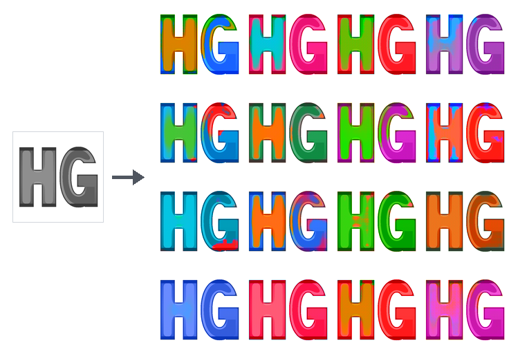

#  HyperGAN



_HyperGAN 2.0 logo ([single badge](docs/assets/hypergan-logo.png) · [4×4 colorized grid](docs/assets/hypergan-logo-grid.png) · [grayscale HG source](docs/assets/hg-bw-128.png)) generated by conditioning the [128×128 HNDL particle colorizer](docs/colorization.md) ([`examples/logos-colorization-128.toml`](examples/logos-colorization-128.toml)) on a single grayscale **HG** monogram across 16 particle draws._

HyperGAN is being rebuilt to make proven GANs configurable and practical: prepare data, train, inspect samples, recover runs, and build generators for applications. The next release integrates on `develop`, using [ParticleGAN](https://github.com/255BITS/ParticleGAN) primitives inside a HyperGAN-owned training loop.

The current foundation supports native CUDA training, flexible Python components, complete training checkpoints, a Docker-style CLI for managing live and historical runs from any directory, a functional Python API (`import hypergan as hg`), and a local Web Observatory (`hypergan view`). The first measured image recipe is [CIFAR-10 with ParticleGAN and a pretrained discriminator](docs/cifar-recipe.md), with a scratch generator, PNG previews and explicit FID evaluation. New projects target CUDA; CPU execution is explicit for small correctness fixtures. Full image reproduction, actual two-GPU image qualification and real cluster training remain release gates. Custom configurations still require their own qualification.

The [128×128 and 256×256 logo colorization recipes](docs/colorization.md) pair a multi-input HNDL conditional generator (with exact 7-face polytope luminance lock and bilinear particle palette synthesis) with a multidepth DINOv3 projected critic, held-out color and structure metrics, and multiple sampled colorizations.

---

## Install the development foundation

Use Python 3.12+ for the tested training runtime. Lightweight package checks cover Python 3.11–3.14 on Linux, macOS and Windows; the CPU reference profile is tested on Linux.

```sh
git clone --branch develop https://github.com/HyperGAN/HyperGAN.git
cd HyperGAN
python -m venv .venv
. .venv/bin/activate
python -m pip install .
hypergan --help
python -m hypergan --version
```

For local NVIDIA GPU training, install the CUDA runtime and training/web/image extras:

```sh
python -m pip install 'torch==2.14.0' --index-url https://download.pytorch.org/whl/cu130
python -m pip install '.[train,image,web]'
```

For a CPU correctness fixture, install the CPU PyTorch wheel instead (`--index-url https://download.pytorch.org/whl/cpu`) and pass `--device cpu` (or `-d cpu`). Lightweight CLI commands (`new`, `validate`, `ps`, `status`, `logs`, `inspect`, `tag`, `runs`, `queue`, `prune`, `rm`) do not import PyTorch or ParticleGAN.

---

## Quickstart: Project Scaffolding & Starter Templates

Explore starter architectures (`dcgan`, `tiny-transformer`, `resnet`, `gaussian-grid`) or packaged recipes:

```sh
hypergan new --list
hypergan recipes
```

Scaffold a complete project workspace (`hypergan.toml`, `runs/`, and `configs/<template>.toml`). When `--dataset` points at an image folder, `hypergan new` inspects image headers without loading pixels into RAM, auto-detects the resolution (`32`, `64`, `128`, or `256`) and color mode (`RGB` or `L`), and sizes the generator/critic HNDL architectures automatically:

```sh
# Image GAN project sized automatically from a folder of images
hypergan new --project my_gan --dataset ./images

# Or specify an explicit template and resolution (or 2D toy fixture on CPU)
hypergan new --project my_transformer --template tiny-transformer --resolution 64
hypergan new --project my_toy --template gaussian-grid --device cpu
```

Validate the generated `format = "hypergan-model/1"` configuration (or the project directory itself):

```sh
# Fast structural validation (no Torch imports)
hypergan validate my_gan/configs/dcgan.toml
hypergan validate my_gan

# Validate with inline overrides and emit resolved JSON
hypergan validate my_gan/configs/dcgan.toml -s train.batch_size=32 -s optimizer.lr=0.0002 --json

# Verify image dataset inventory/hashes (--data) and construct networks in a worker (--runtime)
hypergan validate my_gan/configs/dcgan.toml --data
hypergan validate my_gan/configs/dcgan.toml --runtime
```

---

## Training & Docker-Style Live Run Management

Start training from a model `.toml` file. You can customize the run name (`-n`), override any config setting (`-s KEY=VALUE`), or select the execution device (`-d`):

```sh
hypergan train my_gan/configs/dcgan.toml --steps 1000
hypergan train my_gan/configs/dcgan.toml -n exp-lr2e4 -s train.lr=0.0002 -s train.batch_size=32
hypergan train my_toy/configs/gaussian-grid.toml --steps 20 -d cpu --no-server
```

Every run is registered in a daemonless global registry with a unique **Run ID** (`<short_id>`, e.g. `0608d849`), a memorable Docker-style **Slug** (`<adj>-<noun>`, e.g. `fleet-hawk`), and an experiment **Name** / tag. You can inspect and control runs from **any working directory** using zero arguments (which automatically targets the active or most recent run) or by passing `<slug>`, `<short_id>`, `<tag>`, or `<run_dir>`:

```sh
# List active runs, live GPU VRAM usage, and queued jobs
hypergan ps

# List all historical runs (active, completed, stopped, failed) across the host/workspace
hypergan ps -a
hypergan ps -a --json

# Concise single-screen status summary (progress, speed, ETA, latest losses, best FID, checkpoints)
hypergan status
hypergan status fleet-hawk

# View or follow (-f) formatted training logs (Ctrl-C detaches without stopping training)
hypergan logs -n 50
hypergan logs -f fleet-hawk

# Request an immediate durable checkpoint at the next update boundary
hypergan checkpoint
hypergan checkpoint fleet-hawk

# Gracefully stop an active run (saves a complete checkpoint before exiting)
hypergan stop
hypergan stop fleet-hawk
hypergan stop --all
```

---

## Post-Run Inspection, Tagging, Resuming, Sampling, Evaluation, Export & Cleanup

### Tagging & Inspecting Runs
```sh
# Rename or tag a run in its manifest, summary, and global registry
hypergan tag fleet-hawk baseline-dcgan32

# Inspect full run manifest JSON or model architecture/loss/optimizer summary
hypergan inspect baseline-dcgan32
hypergan model baseline-dcgan32
hypergan model baseline-dcgan32 --write   # build on meta device and save RUN/model.json
```

### Resuming Training
Continue a stopped or completed run from its latest checkpoint (or a specific `--checkpoint`). When `lr_floor = 1.0` (constant learning rate), `--steps` can extend the total step budget seamlessly:

```sh
hypergan resume baseline-dcgan32 --steps 2000
```

### Sampling, Evaluation & Standalone Export
```sh
# Draw fresh samples from the EMA generator (writes PNG grid for image models or JSON)
hypergan sample baseline-dcgan32 --count 16 --seed 42

# Condition a trained colorizer on a single grayscale input image across 16 particles
hypergan sample logos-colorization-128 --input docs/assets/hg-bw-128.png --count 16 --output hg-grid.png

# Run configured snapshot evaluations (e.g. FID, color moments, sample diversity)
hypergan eval baseline-dcgan32
hypergan evaluate baseline-dcgan32 --metric sample_diversity

# Export a standalone, hash-verified EMA inference bundle (model.pt + model.sha256)
hypergan export baseline-dcgan32 --checkpoint latest -o exported_model.pt
```

### Comparing Runs & Multi-GPU Job Queue
```sh
# List and filter runs, or compare metrics across step milestones side-by-side
hypergan runs ls --sort fid
hypergan runs compare baseline-dcgan32 exp-lr2e4
hypergan runs compare baseline-dcgan32 exp-lr2e4 --metric loss_g --at 500,1000,best,latest --json

# Schedule and run experiments sequentially across GPUs
hypergan queue status
hypergan queue add my_gan/configs/dcgan.toml -n job1 --steps 5000 -s train.lr=0.0005 -d gpu0
hypergan queue ls --json
hypergan queue run --once
hypergan queue stop --all
```

### Garbage Collection & Run Removal
```sh
# Reclaim disk space by cleaning rebuildable views and compacting routine train events
hypergan prune baseline-dcgan32 --dry-run
hypergan gc baseline-dcgan32
hypergan checkpoints prune baseline-dcgan32 --dry-run

# Delete a run directory and unregister it from the global registry (-f stops if active)
hypergan rm exp-lr2e4
```

---

## Web Observatory (`hypergan view`)

With `.[web]` installed, `hypergan train` and `hypergan resume` automatically launch a background Web Observatory on `0.0.0.0:8765` (or the next free port; disable with `--no-server`). You can also start, inspect, or stop the Web Observatory for any runs root or individual run (`<slug>`, `<short_id>`, `<tag>`, or path):

```sh
# Start the global runs dashboard and per-run observatory
hypergan view
hypergan view my_gan/runs --port 8765 --open
hypergan view baseline-dcgan32 --port 8765

# Check status or stop a background dashboard
hypergan view --status
hypergan view --stop
```

The Web Observatory provides:
- **Global Runs Dashboard (`GET /` and `GET /api/runs`)**: Live-updating table of all runs with search/status filtering, progress bars, throughput (`it/s`), latest/best FID, disk usage, and one-click **Checkpoint** (`POST /api/runs/<id>/checkpoint`) and **Stop** (`POST /api/runs/<id>/stop`) controls for active runs.
- **Per-Run Observatory (`GET /runs/<id_or_slug_or_tag>`)**: Real-time learning curves backed by a WebAssembly streaming reducer, retained EMA sample history sliders, snapshot evaluation charts, and the **Model** tab showing the ParticleGAN integration, loss metrics, and per-layer HNDL network tables.

See [Local browser and streaming API](docs/local-web.md) for authentication (`--auth token`), TLS proxy setup (`--public-origin`), and the full `/api/runs/*` and `/api/v1/runs/*` REST/SSE contract.

---

## Python Developer API (`import hypergan as hg`) & Environment Variables

Everything available in the CLI is exposed as a clean, functional Python API at the top level of `hypergan` (lazy-loaded so importing `hypergan` never imports PyTorch until training or sampling runs):

```python
import hypergan as hg

# 1. Scaffold or load a model configuration
info = hg.new(project="my_gan", template="dcgan", dataset="./images", device="cpu")
model = hg.load(info["recipe_path"])
model = hg.override(model, {"train.steps": 100, "train.batch_size": 16})
warnings = hg.validate(model)

# 2. Train and inspect runs by slug, short ID, custom tag, or path
run = hg.train(model, "my_gan/runs/exp1", steps=100)
active_and_all = hg.ps(all_runs=True)
all_runs = hg.list_runs()

st = hg.status("exp1")                  # dict with step, status, latest_metrics, best_fid, etc.
log_lines = hg.logs("exp1", tail=20)    # list[str] of formatted log lines (silent on stdout)
manifest = hg.inspect("exp1")           # dict of the run's manifest.json
hg.tag("exp1", "my-best-gan")

# 3. Sample, export, and reload inference bundles
sample = hg.sample("my-best-gan", count=8, seed=42)
bundle_path = hg.export("my-best-gan", checkpoint="latest")
bundle = hg.load_bundle(bundle_path)    # or hg.load(bundle_path)

# 4. Clean up
hg.prune("my-best-gan", dry_run=True)
hg.rm("my-best-gan")
```

### Environment Variables

| Variable | Purpose |
| --- | --- |
| `HYPERGAN_HOME` / `HYPERGAN_STATE_DIR` | Override the directory used for the global run registry (`runs.json` and `registry.lock`). Defaults to `~/.local/share/hypergan` (or `$XDG_DATA_HOME/hypergan`). Setting either variable isolates run discovery to that state directory. |
| `HYPERGAN_WORKSPACE` | Explicitly point to a workspace `hypergan.toml` file (or its parent directory) when running outside the workspace directory tree. |
| `HYPERGAN_QUEUE_FILE` | Override the path to the multi-GPU job queue state file (defaults to `<workspace>/.hypergan/queue.json` or `./.hypergan/queue.json`). |
| `HYPERGAN_VIEWER_DEV` | Set to `1` (`true`/`yes`/`on`) to serve Web Observatory frontend assets fresh from disk on every request with auto-reload. |

---

## Configure the recipe

`hypergan new` generates `format = "hypergan-model/1"` TOML model files (`[data]`, `[prior]`, `[networks.generator]`, `[networks.discriminator]`, `[[losses]]`, `[train]`, `[metrics]`, `[evaluations.<id>]`, `[checkpoints]`, `[sampling]`). During validation and training, HyperGAN lowers the model file into the engine's resolved numerical recipe.

ParticleGAN supplies the released GAN formulation and its selected defaults for loss, learning rates, hyperparameters, normalization and optimizers. HyperGAN consumes its public recipe and owns networks, data, execution, checkpoints and metrics. See the [integration boundary](docs/particlegan.md). Networks are declared in HNDL (`source = "..."` or `hndl = "file.hndl"`) or importable Python modules (`module = "pkg.mod:Class"`), with full source recorded in every run.

See:
- [Configuration and component contracts](docs/configuration.md) and the [paired synthetic example](examples/paired-linear.toml)
- [Image data and preprocessing](docs/image-data.md)
- [Recovery and compatibility](docs/recovery.md) and [Run observation contract](docs/observation.md)
- [Public execution profiles](docs/execution.md), [Execution profiles and preflight](docs/execution-profiles.md), [Replicated run service](docs/replicated-run-service.md), [CUDA/NCCL workers](docs/replicated-cuda.md), and [Bounded previews and progress](docs/replicated-observation.md)

## Development and migration

The map/reduce storage and shared Rust reducers now live in **Foldlite DB**.
This branch requires `foldlitedb>=0.1.2,<0.2`:

```sh
python -m pip install "foldlitedb>=0.1.2,<0.2"
python -m pip install -e '.[dev,web]'
```

CI accepts the repository variable `FOLDLITEDB_SOURCE` as a wheel URL or a pip
source reference pinned to an exact revision. Without that variable it uses the
configured package index, which requires Foldlite DB to have been released.
See the [Foldlite integration and cache contract](docs/foldlitedb.md).

Install `.[dev,train,image,web]` in the tested runtime environment, then run `python -m pytest` for CPU and lightweight correctness tests. That default selection deselects the `heavy` marker, which gates the tests that start real subprocesses, multi-rank jobs and worker services; run those deliberately with `python -m pytest -m heavy`. With two visible NVIDIA GPUs and the CUDA runtime, run `python -m pytest tests/cuda`; see [CUDA execution and validation](docs/cuda.md).

Historical HyperGAN code and experiments are preserved in archive tags. Legacy configurations and checkpoints require their archived runtime; see [migration notes](docs/migration.md), [preservation evidence](reports/resurrection-preservation-2026-09-18.md), [the execution ledger](reports/resurrection-status.md), and [resurrection plan](reports/resurrecting-hypergan-plan-2026-09-18.md).
