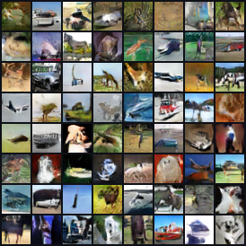
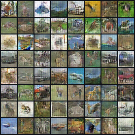
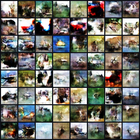
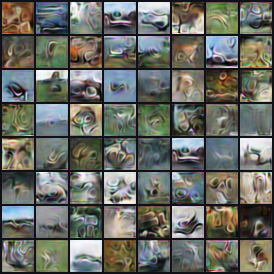
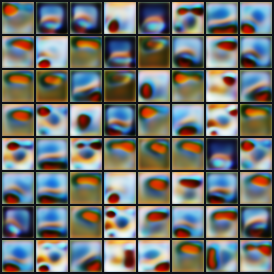
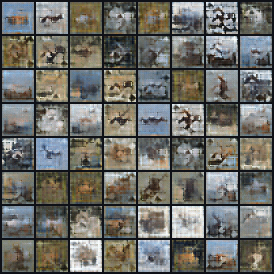
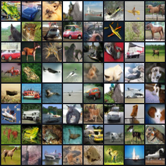

# HyperGAN 2.2.0 / ParticleGAN 0.12.0 (`unified_v12`) Reproducible Benchmark & Diagnostic Report

> [!NOTE]
> This report documents a reproducible, zero-seed-sweep evaluation campaign for **HyperGAN 2.2.0** and **ParticleGAN 0.12.0 (`unified_v12`)** using pure declarative `hypergan-model/1` + native HNDL architectures, single-pass `InceptionSuite` and `DINOv2Suite` (50,000 samples), and verified telemetry read directly from run receipts. It reports both `unified_v12`'s stability advantages and its concrete quality, convergence-speed, and throughput regressions honestly to guide the next release.

## Executive Summary

We benchmarked **HyperGAN 2.2.0** (`particlegan==0.12.0`, `hndl==0.13.0`, `foldlitedb==0.5.0`, `torch==2.14.1`) across **11 exported EMA bundles** evaluated at **50,000 samples** (`seed = 34002`) on both **Inception-v3** (`InceptionSuite`: FID + k-NN Precision, Recall, Density, Coverage) and self-supervised **DINOv2 ViT-L/14** (`DINOv2Suite`: `FD_DINOv2` + k-NN Precision, Recall, Density, Coverage), totaling **235.71 Google Colab Compute Units** (`4,916.98 -> 4,681.27 CU`, strictly `<= 3` concurrent GPUs, zero seed sweeps):

- **Decisive zero-override stability win on deep unnormalized architectures:** Across every `unified_v12` run (now pinned via `defaults = "particlegan:unified_v12"` with zero recipe or optimizer overrides), training completed with **0 NaNs, 0 collapse alerts, and 0 divergences**. On the 13.5M-parameter **unnormalized scratch ResNet-GAN** (CIFAR-10 32×32, GroupNorm+SiLU generator, unnormalized SiLU+AvgPool critic), `unified_v12` reached **`FID-50k = 150.63`** and **`FD_DINOv2 = 2482.96`** at 25k steps (still improving smoothly from `235.15 @ 10k -> 171.95 @ 20k -> 150.63 @ 25k`), beating a fair `Adam + R1 (γ = 1.0)` baseline on the byte-identical HNDL graphs (**`FID-50k = 314.03`**, **`FD_DINOv2 = 2943.95`**) by **>2× lower FID**, **25× higher Inception Precision** (`0.3363` vs `0.0134`), **11× higher Inception Density** (`0.2925` vs `0.0267`), **17× higher Inception Coverage** (`0.0611` vs `0.0035`), and **-461.0 pts `FD_DINOv2`**. Standard `Adam + R1` sat trapped at the flat-critic fixed point `D ≡ 0` (`loss/d_adversarial = 1.3863 = ln 4`, `grad_norm/G ≈ 1e-5`) for 16,100 steps before spiking chaotically (`grad_norm/D: 0.00013 -> 59.74`) and exploding (`FID 180.09 -> 371.52 -> 314.03`).
- **Clear quality & recall regressions on well-conditioned models:** Where classical baselines already train stably, `unified_v12` defaults trail badly on image FID and manifold recall. On **Radford BN-DCGAN**, `Adam + R1` reached **`FID-50k = 33.75`** (`FD_DINOv2 = 1203.56`, Inc Recall `0.4201`) in 50k steps (`30.6 min` on an L4), whereas `unified_v12` with the default discrete `particles` prior reached `133.31 @ 50k`, `117.98 @ 70k` (best), and `132.33 @ 100k` (`FD_DINOv2 = 1570.40`, DINOv2 Precision `0.8874`, Density `6.6438`, Recall `0.0004`). On **scratch pure-Transformer TransGAN** (`13.0M` params), `unified_v12` reached `162.01 @ 25k` (`FD_DINOv2 = 1919.21`) versus the historical ParticleGAN `0.10.0 EMPF` reference of **`51.30 @ 22.5k`**. On the **pretrained ResNet-18 critic** (`cifar10-tiny-transformer`), 25k FID regressed from `15.58` (`0.9.7 BISPF`) and `16.06` (`0.10.0 EMPF`) to `19.39` (`0.11.1 unified_v11`) and `31.20` (`0.12.0 unified_v12`).
- **Four actionable root causes identified during the 2.2.0 campaign:** (1) `training.ema = 0.0` under `unified_v12` (raw un-averaged weights vs `ema = 0.999`), (2) conservative effective step size (`lr = 0.014`, `d_lr_mult = 1.5`, 0-NS Frobenius-MP on 4D Conv2d) causing slow convergence and precision-concentrated / low-recall modes, (3) discrete `particles` prior (`16,384` points) vs continuous `mog` prior (`91.94 @ 23.9k` vs `133.31 @ 50k`), and (4) `recipe.training_precision = "bf16_channels_last"` was not yet wired into HyperGAN's `ReferenceTrainer` / `objective_program.py` during the 2.2.0 campaign (leaving those measurements in pure NCHW FP32 at `0.93 it/s` on 32px ResNet and `0.33 it/s` on 64px ResNet on A100-40GB; `training.precision = "bf16_channels_last"` has since been wired into HyperGAN's trainer).

---

## Protocol & Fairness Contract

All scratch-critic benchmark configurations live under [`benchmarks/whitepaper/`](../benchmarks/whitepaper/README.md) and adhere to strict declarative and statistical fairness rules:

1. **Pure Declarative HNDL Architectures:** Every generator and discriminator is defined natively in `format = "hypergan-model/1"` + HNDL (`factory = "hndl"`), with **no custom PyTorch `nn.Module` shortcuts, no spectral normalization, and no Adaptive Discriminator Augmentation (ADA)** (both paired TransGAN configs include identical fixed, non-adaptive in-graph `diff_augment(transforms="translation,cutout,color")` in the discriminator). Every `*-v12.toml` and `*-adam.toml` pair uses **byte-identical Generator and Discriminator HNDL graphs**, identical initialization (`deterministic_orthogonal` on DCGAN and ResNet pairs; HNDL `constructor` initialization on TransGAN), identical CIFAR-10 data pipelines (`batch_size = 256`, random horizontal flips during training), and `seed = 0` (zero seed sweeps).
2. **Zero-Override `unified_v12` vs Fair `Adam + R1`:**
   - **`unified_v12` (`*-v12.toml`):** Declares pinned `defaults = "particlegan:unified_v12"` with **zero `[recipe]`, `[penalty]`, or optimizer overrides** (`optimizer_family = "unified_v12_equil"`, `lr = 0.014`, `d_lr_mult = 1.5`, `prior_lr_mult = 2.9`, `ema_decay = 0.0`, `kind = "particles"`, `num_particles = 16384`).
   - **`Adam + R1` (`*-adam.toml`):** Declares `defaults = "hypergan"` with fused PyTorch Adam (`lr = 0.0002`, `d_lr_mult = 1.0`, `betas = [0.5, 0.999]` for Radford BN-DCGAN and `[0.0, 0.999]` for ResNet-GAN), non-saturating logistic loss, pure Mescheder et al. (2018) R1 gradient penalty (`reg_real_weight = 1.0`, `reg_fake_weight = 0.0`, `penalty = 1.0`, `lazy_k = 1`), isotropic Gaussian prior, inference `ema = 0.999`, and all ParticleGAN-specific interventions explicitly disabled.
3. **SHA-256-Pinned Weights & Datasets:**
   - **Inception-v3 (`torch-fidelity==0.4.0`):** `weights-inception-2015-12-05-6726825d.pth` — SHA-256 `6726825d0af5f729cebd5821db510b11b1cfad8faad88a03f1befd49fb9129b2`.
   - **DINOv2 ViT-L/14 (LVD-142M, self-contained PyTorch ViT):** `dinov2_vitl14_pretrain.pth` — SHA-256 `d5383ea8f4877b2472eb973e0fd72d557c7da5d3611bd527ceeb1d7162cbf428`.
   - **ResNet-18 (frozen pretrained-critic audit only):** `resnet18-f37072fd.pth` — SHA-256 `f37072fd47e89c5e827621c5baffa7500819f7896bbacec160b1a16c560e07ec`.
   - **FFHQ-64 (70,000 aligned 64×64 RGB faces):** SHA-256 `76af01fc2b10b6631e08713365c7ae2a9d8ee99a7a62ac834ade684a913094ff` (`877.7 MB`).
4. **Single-Pass `InceptionSuite` & `DINOv2Suite` Evaluation:** Every reported post-hoc suite score evaluates the exported standalone `model.pt` bundle using `python -m hypergan.image_metrics` (`N = 50,000` generated samples vs all `50,000` unaugmented sequential CIFAR-10 training images, `batch_size = 128`, `seed = 34002`, `data_seed = 34003`, `prior_seed = 34004`, uint8 RGB quantization, FP32 with TF32 disabled, float64 unbiased covariance). Precision/Recall (Kynkäänniemi et al., 2019, `pr_k = 3`) and Density/Coverage (Naeem et al., 2020, `dc_k = 5`) are computed over a deterministic `manifold_samples = 10,000` subset in the same pass as FID / `FD_DINOv2`. See [Image FID and multi-metric evaluation](image-fid.md).

---

## Table 1 — CIFAR-10 32×32 Scratch-Critic Matrix

All runs use global `batch_size = 256` and train both Generator and Discriminator completely from scratch (no pretrained backbone). `Eval FID-50k`, `Inc P/R/D/C`, `FD_DINOv2`, and `DINO P/R/D/C` are measured on the final exported bundle at `Eval Step`.

| Architecture (G / D Params) | Formulation & Prior (`run_id`) | Eval Step | Best Online FID (@ step) | Eval FID-50k | Inc P / R / D / C | FD_DINOv2 | DINO P / R / D / C | `div/ratio` | Stability / Alerts | Train Speed & Time |
| :--- | :--- | ---: | ---: | ---: | :---: | ---: | :---: | ---: | :--- | :--- |
| **BN-DCGAN**<br>(`1.18M` / `0.66M`) | **Adam + R1**, Gaussian, `ema=0.999`<br>(`01ce0c53`) | 50k | **33.75** (50k) | **33.75** | `0.506 / 0.420 / 0.477 / 0.413` | **1203.56** | `0.769 / 0.026 / 2.345 / 0.068` | 1.022 | Clean (`0` alerts, `acc=0.871`) | L4 · `42.68 it/s` · `1,837 s` (`0.51 h`) |
| **BN-DCGAN**<br>(`1.18M` / `0.66M`) | **`unified_v12`**, `particles`, `ema=0.0`<br>(`99bf530f`) | 100k | 117.98 (70k) | 132.33 | `0.358 / 0.038 / 0.275 / 0.069` | 1570.40 | `0.887 / 0.0004 / 6.644 / 0.046` | 0.991 | `0` NaNs; critic sat. (`acc=1.00`) | A100 · `10.39 it/s` · `10,305 s` (`2.86 h`) |
| **BN-DCGAN (MoG ablation)**<br>(`1.18M` / `0.66M`)¹ | **`unified_v12`**, `mog (σ_rel=0.025)`, `ema=0.0`<br>(`b2e8b135`) | 23.9k | 91.94 (23.9k) | 91.94 | `0.562 / 0.029 / 0.486 / 0.164` | 1686.89 | `0.872 / 0.000 / 4.308 / 0.036` | 1.127 | `0` NaNs; critic sat. (`acc=1.00`) | A6000 · `26.11 it/s` · `1,147 s` (`0.32 h`) |
| **Scratch ResNet-GAN**<br>(`6.03M` / `7.43M`) | **`unified_v12`**, `particles`, `ema=0.0`<br>(`013ae4ea`) | 25k | 171.95 (20k)² | **150.63** | `0.336 / 0.005 / 0.292 / 0.061` | **2482.96** | `0.284 / 0.000 / 0.563 / 0.019` | 0.806 | **Clean (`0` alerts, `acc=0.898`)** | A100 · `0.93 it/s` · `29,661 s` (`8.24 h`) |
| **Scratch ResNet-GAN**<br>(`6.03M` / `7.43M`) | **Adam + R1**, Gaussian, `ema=0.999`<br>(`63a7875b`) | 25k | 176.60 (10k) | 314.03 | `0.013 / 0.000 / 0.027 / 0.004` | 2943.95 | `0.130 / 0.000 / 0.103 / 0.004` | 0.917 | **Flat-D stagnation -> explosion** | A100 · `1.87 it/s` · `13,987 s` (`3.89 h`) |
| **Scratch TransGAN**<br>(`2.84M` / `10.20M`) | **`unified_v12`**, `particles`, `ema=0.0`<br>(`547cc23f`) | 25k | 162.01 (25k) | **162.01** | `0.261 / 0.001 / 0.110 / 0.021` | **1919.21** | `0.756 / 0.000 / 2.708 / 0.030` | 0.722 | **Clean (`0` alerts, `acc=0.813`)** | A100 · `0.93 it/s` · `27,670 s` (`7.69 h`) |
| **Scratch TransGAN (Ref.)**<br>(`2.84M` / `10.20M`)³ | **ParticleGAN `0.10.0 EMPF`**, `mog`, `ema=0.0`<br>(`f2cce6c4`) | 25k | **51.30** (22.5k) | 67.04³ | — | — | — | 1.140 | Clean (`acc=0.496`) | 2× A6000 · `0.47 it/s` · `57,035 s` (`15.84 h`) |

- ¹ *`cifar10-dcgan-og-bn-proj-unified-v12-0120-default` uses the identical Radford BN-DCGAN topology minus 68 bias scalars on `deconv(3)`, `conv(64)`, and `linear(1)` (`1,183,616` G / `663,296` D), with `prior.kind = "mog"` (`sigma_rel = 0.025`, `rows = "full"`), `seed = 24002`, and async `cuda:1` evaluation.*
- ² *`wp-cifar10-resnet-scratch-v12` scheduled online `fid50k_train` every 10k steps (`10k: 235.15`, `20k: 171.95`); its exported step-25,000 bundle evaluated post-hoc at `FID-50k = 150.63`.*
- ³ *Historical baseline from [CIFAR recipes & results](cifar-recipe.md) (`cifar10-transgan-empf-010-2gpu`); `67.04` is the recorded online `fid50k_train` at step 25,000 (not evaluated on `InceptionSuite` / `DINOv2Suite` in this campaign).*

### Online FID-50k Trajectories (Scratch-Critic Runs)

*(Checked-in configs default to `every = 10000`; campaign runs on `wp-cifar10-resnet-scratch-adam`, `wp-cifar10-transgan-scratch-v12`, and `wp-ffhq64-resnet-v12` overrode online `fid50k_train` cadence to `every = 5000`.)*

| Run | 5k | 10k | 15k | 20k | 25k | 30k | 50k | 70k | 100k |
| :--- | ---: | ---: | ---: | ---: | ---: | ---: | ---: | ---: | ---: |
| `wp-cifar10-dcgan-bn-adam` | — | 64.65 | — | 41.77¹ | — | 37.04 | **33.75** | — | — |
| `wp-cifar10-dcgan-bn-v12` (`particles`) | — | 225.59 | — | 166.34 | — | 154.63 | 133.31 | **117.98** | 132.33 |
| `cifar10-dcgan-og-bn-proj` (`v12` + `mog`) | 190.73² | 114.65² | 102.02² | 95.40² | **91.94**² | — | — | — | — |
| `wp-cifar10-resnet-scratch-v12` | — | 235.15 | — | 171.95 | **150.63** | — | — | — | — |
| `wp-cifar10-resnet-scratch-adam` | 216.89 | **176.60** | 180.09 | 371.52 | 314.03 | — | — | — | — |
| `wp-cifar10-transgan-scratch-v12` | 216.99 | 182.13 | 209.77 | 175.75 | **162.01** | — | — | — | — |
| `cifar10-transgan-empf-010-2gpu` (Ref.) | 69.68 | 83.25 | 56.65 | 66.13 | 67.04 (best `51.30 @ 22.5k`) | — | — | — | — |

- ¹ *Evaluated at step `21,195` (`40k: 34.62`).*
- ² *Async `cuda:1` snapshots landed at steps `2,500 (190.73)`, `7,079 (125.60)`, `9,828 (114.65)`, `12,588 (106.21)`, `15,421 (102.02)`, `18,277 (98.04)`, `21,039 (95.40)`, and `23,931 (91.94)`.*

### Cancelled & Early-Stopped Runs

To conserve Google Colab Compute Units ahead of the next release, three queued or in-progress runs from [`benchmarks/whitepaper/`](../benchmarks/whitepaper/README.md) were stopped or cancelled cleanly:

- **`wp-ffhq64-resnet-v12` (`70f9b21f`, FFHQ-64 64×64, `6.22M` G / `7.84M` D):** Stopped early at step **4,560** (`15,944 s` / `4.43 h` on 1× A100-40GB, `0.325 it/s`) before reaching its first step-5,000 FID evaluation. Training was numerically stable throughout: `critic/accuracy = 0.793`, `critic/margin = 3.272`, `diversity/ratio = 0.988`, `0` alerts, `0` NaNs.
- **`wp-cifar10-transgan-scratch-adam` & `wp-ffhq64-resnet-adam`:** Cancelled prior to launch ahead of the next release.

---

## Table 2 — Pretrained-Critic (`cifar10-tiny-transformer`) Feature-Leakage Audit

To audit how ParticleGAN's optimizer/formulation evolution affects both **Inception-v3** and **self-supervised DINOv2** distributions—and to measure feature leakage when training with a frozen ImageNet-pretrained critic—we evaluated all **5 historical 25k-step runs** of `cifar10-tiny-transformer` (`2,489,731` trainable G params; `171,779` trainable + `11,689,512` frozen ResNet-18 D params; `mog` prior `16,384 × 64`, `fixed_sigma = 0.212616428732872` overriding `sigma_rel`; `training.ema = 0.0`; 2× RTX A6000 global batch 256) on `InceptionSuite` + `DINOv2Suite` (`N = 50,000`, `seed = 34002`, Colab L4):

| ParticleGAN Preset (`run_id`) | Optimizer & LR | Best Online FID (@ step) | Eval FID-50k (25k) | Inc P / R / D / C | FD_DINOv2 (25k) | DINO P / R / D / C | `div/ratio` | Train Speed (2× A6000) |
| :--- | :--- | ---: | ---: | :---: | ---: | :---: | ---: | :--- |
| **`0.9.7 BISPF`** (`117ab950`) | `dualnorm`, `lr=0.012`, `d_mult=1.5` | **14.56** (15k) | **15.58** | `0.535 / 0.532 / 0.580 / 0.647` | **938.40** | `0.644 / 0.100 / 1.426 / 0.106` | 0.985 | `3.13 it/s` (`8,649 s`) |
| **`0.10.0 EMPF`** (`3e046470`) | `dualnorm`, `lr=0.012`, `d_mult=1.5` | 15.16 (12.5k) | 16.06 | `0.541 / 0.531 / 0.577 / 0.647` | 950.33 | `0.646 / 0.100 / 1.439 / 0.102` | 1.005 | `3.32 it/s` (`9,005 s`) |
| **`0.11.1 unified_v11`** (`4581aafd`) | `unified_v11_equil`, `lr=0.014`, `d_mult=1.5` | 19.39 (25k) | 19.39 | `0.521 / 0.534 / 0.520 / 0.565` | 1032.14 | `0.697 / 0.076 / 1.721 / 0.084` | 1.013 | `5.18 it/s` (`5,508 s`) |
| **`0.12.0 unified_v12`** (`c1006c7a`) | `unified_v12_equil`, `lr=0.014`, `d_mult=1.5` | 31.20 (25k) | 31.20 | `0.439 / 0.412 / 0.375 / 0.403` | 1122.13 | `0.740 / 0.033 / 2.430 / 0.065` | 0.967 | `5.24 it/s` (`5,291 s`) |
| **`0.12.0 unified_v12` (LR 7×)** (`7bddb545`) | `unified_v12_equil`, `lr=0.10`, `d_mult=1.2` | 28.12 (22.5k) | 28.14 | `0.476 / 0.374 / 0.433 / 0.446` | 1123.76 | `0.726 / 0.015 / 2.113 / 0.072` | 1.002 | `5.29 it/s` (`5,264 s`) |

### What `FD_DINOv2` + PRDC Catch That Inception FID Hides

1. **Precision-for-recall trade-off missed by Inception FID:** Increasing `unified_v12`'s learning rate (`0.014 -> 0.10`) improved **Inception FID** by **-3.06 pts** (`31.20 -> 28.14`) and boosted Inception Precision (`0.439 -> 0.476`) and Coverage (`0.403 -> 0.446`), yet **`FD_DINOv2` did not improve (`1122.13 -> 1123.76`)** and **DINOv2 Recall fell by more than half (`0.0328 -> 0.0148`)** alongside falling Inception Recall (`0.4115 -> 0.3741`). Optimizing Inception FID alone would falsely declare `lr=0.10` strictly better while hiding mode contraction.
2. **Monotonic mode-tightening across `BISPF -> EMPF -> v11 -> v12`:** Moving from `0.9.7 BISPF` to `0.12.0 unified_v12` increased DINOv2 Precision (`0.644 -> 0.740`) and DINOv2 Density (`1.426 -> 2.430`)—meaning generated samples cluster tightly inside dense pockets of the real manifold—while cutting DINOv2 Recall by **3×** (`0.100 -> 0.033`) and Coverage by **38%** (`0.106 -> 0.065`).
3. **ImageNet feature leakage in pretrained-critic FID:** Even the strongest pretrained-critic run (`BISPF`, Inception FID `15.58`, Inception Recall `0.532`) records **`FD_DINOv2 = 938.40`** and **DINOv2 Recall `0.100`**. Because both the frozen ResNet-18 critic and Inception-v3 are supervised ImageNet-1k classifiers, Inception FID partially rewards matching supervised ImageNet texture statistics; pairing `InceptionSuite` with self-supervised `DINOv2Suite` exposes the true remaining gap in structural diversity.

---

## Visual Sample Grids (8×8, Seed `123`)

All grids below are uncurated 8×8 (`count = 64`, `seed = 123`) draws rendered deterministically on CPU via `hypergan.load_bundle(..., device="cpu")` from each run's exported `model.pt` bundle (32×32 tiles, 2 px border).

### CIFAR-10 Radford BN-DCGAN (Scratch Critic)

| Adam + R1 (50k · FID `33.75` · FD_DINOv2 `1203.56`) | `unified_v12` Particles (100k · FID `132.33` · FD_DINOv2 `1570.40`) | `unified_v12` MoG Ablation (23.9k · FID `91.94` · FD_DINOv2 `1686.89`) |
| :---: | :---: | :---: |
|  |  |  |

### CIFAR-10 Scratch ResNet-GAN (13.5M, Unnormalized Critic)

| `unified_v12` (25k · FID `150.63` · FD_DINOv2 `2482.96`) | Adam + R1 (25k · FID `314.03` · FD_DINOv2 `2943.95` — collapsed) |
| :---: | :---: |
|  |  |

### CIFAR-10 Pure-Transformer TransGAN & Pretrained-Critic Reference

| Scratch TransGAN `unified_v12` (25k · FID `162.01` · FD_DINOv2 `1919.21`) | Pretrained-Critic `cifar10-tiny-transformer` `0.9.7 BISPF` (25k · FID `15.58` · FD_DINOv2 `938.40`) |
| :---: | :---: |
|  |  |

---

## Honest Scientific Diagnosis: Strengths, Regressions & 4 Root Causes

### Genuine Strength: Unconditional Stability on Hard Scratch Architectures

`unified_v12` delivered on its primary design promise of **zero-override numerical stability**:

- Every `unified_v12` run across BN-DCGAN (100k steps), 13.5M unnormalized scratch ResNet-GAN (25k steps), 13.0M pure-Transformer scratch TransGAN (25k steps), and 14.1M 64×64 FFHQ ResNet-GAN (4,560 steps) ran with **zero NaNs, zero exploding gradients, and zero mode-collapse alerts**.
- On the 13.5M unnormalized scratch ResNet-GAN, the exact same HNDL architecture caused standard `Adam + R1 (γ = 1.0)` to collapse into the classic flat-critic saddle (`D ≡ 0`): from step `100` to step `16,100`, `loss/d_adversarial` sat frozen at `1.3863` (`ln 4`), `loss/g_adversarial` sat at `0.6931` (`ln 2`), `critic/margin` sat at `0.0000`, and `grad_norm/generator` withered to `1e-5`. At steps `16,180–16,410`, the critic suddenly broke out (`loss/d_adversarial` swung from `2.1638` to `0.4422`, `grad_norm/critic` jumped `0.00013 -> 59.74`, `grad_norm/generator` jumped `0.00001 -> 3.30`), destroying the generator (`FID 180.09 @ 15k -> 371.52 @ 20k -> 314.03 @ 25k`). Under zero-override `unified_v12`, `critic/accuracy` held in a smooth `0.73–0.94` band with `diversity/ratio = 0.71–0.85` and monotonically declining FID (`235.15 -> 171.95 -> 150.63`).

### Four Root Causes Behind Slow Convergence & High Image FID

Comparing `unified_v12` against `Adam + R1` (BN-DCGAN) and earlier ParticleGAN presets (`0.9.7 BISPF`, `0.10.0 EMPF`, `0.11.1 unified_v11`) isolates **four concrete, fixable causes** for the next release:

1. **`training.ema = 0.0` in `unified_v12`:** ParticleGAN `0.12.0`'s `unified_v12` recipe declares `ema_decay = 0.0`, which HyperGAN lowers directly to `training.ema = 0.0` (verified in every `v12` run's `manifest.json`). As a result, every `unified_v12` evaluation and exported `model.pt` bundle scores **raw, un-averaged generator weights**, whereas the `Adam + R1` baseline uses `training.ema = 0.999`. In convolutional and transformer GANs, Polyak/EMA weight averaging (`0.995–0.999`) routinely accounts for a major fraction of FID variance and late-step noise (visible in `wp-cifar10-dcgan-bn-v12` oscillating between `117.98 @ 70k` and `132.33 @ 100k`).
2. **Conservative effective step size & precision-concentrated updates (`lr = 0.014`, `d_lr_mult = 1.5`, 0-NS Frob-MP):** `UnifiedV12Optimizer` combines `lr = 0.014`, `d_lr_mult = 1.5`, and zero-Newton-Schulz Frobenius matrix-polar updates on 4D `Conv2d` layers. On BN-DCGAN, this leaves the critic permanently saturated (`critic/accuracy = 1.000`, `critic/margin = 1.57–3.27`) and drives the generator into ultra-high-precision, ultra-low-recall clusters (**DINOv2 Precision `0.8874`**, **Density `6.6438`**, **Recall `0.0004`**). Even on the easy pretrained-critic benchmark, `unified_v12` regressed monotonically against `dualnorm` (`BISPF`/`EMPF`) on both FID (`15.58 -> 31.20`) and DINOv2 Recall (`0.100 -> 0.033`), and naively cranking `lr` to `0.10` hurt DINOv2 Recall further (`0.033 -> 0.015`).
3. **Discrete `particles` prior vs continuous `mog` prior:** Holding the OG Radford BN-DCGAN architecture and `unified_v12` recipe fixed while switching from the discrete `16,384`-point `particles` prior (`wp-cifar10-dcgan-bn-v12`) to the continuous Mixture-of-Gaussians `mog` prior (`sigma_rel = 0.025`, `rows = "full"`, `cifar10-dcgan-og-bn-proj-unified-v12-0120-default`) cut FID from **`133.31 @ 50k` / `117.98 @ 70k`** down to **`91.94 @ 23.9k`**—more than **2× faster** and **-26 pts lower FID**, with **2.4× higher Inception Coverage** (`0.1639` vs `0.0692`). Discrete particles without continuous kernel smoothing force the generator to fit a finite point cloud and struggle to cover the image manifold.
4. **BF16 autocast + NHWC channels-last (unwired during the 2.2.0 campaign; now wired):** ParticleGAN `0.12.0`'s `unified_v12` recipe specifies `training_precision = "bf16_channels_last"`, which was not yet wired into HyperGAN's `ReferenceTrainer` / `objective_program.py` during the 2.2.0 campaign. Those recorded 2.2.0 measurements therefore executed in **pure NCHW FP32**, capping single-A100-40GB throughput at **`0.93 it/s`** on 32×32 scratch ResNet-GAN / TransGAN and **`0.325 it/s`** on 64×64 FFHQ ResNet-GAN (and making `v12`'s Born-Infeld / probe overhead ~2× slower per step than fused `Adam + R1`: `0.93` vs `1.87 it/s` on ResNet-GAN; `10.39` vs `42.68 it/s` on BN-DCGAN). **Status update:** `training.precision = "bf16_channels_last"` (CUDA BF16 autocast + NHWC channels-last) is now wired into HyperGAN's `ReferenceTrainer`, `objective_program.py`, and `ReplicatedTrainer`.

---

## Reproducibility & Compute Accounting

### Software Stack

- **HyperGAN:** `2.2.0` (`develop` commits `716838de` -> `56e338b6` across PRs `#469`–`#476`)
- **ParticleGAN:** `0.12.0` (`DEFAULT_RECIPE = "unified_v12"`; historical Table 2 runs record `0.9.7`, `0.10.0`, `0.11.1`, and `0.12.0`)
- **HNDL:** `0.13.0` · **Foldlite DB:** `0.5.0` · **PyTorch / TorchVision:** `2.14.1` / `0.29.1`

### Google Colab Compute Unit Accounting

| Metric | Verified Value |
| :--- | :--- |
| Starting Colab balance | `4,916.98 CU` |
| Ending Colab balance | `4,681.27 CU` |
| **Total campaign spend** | **`235.71 CU`** |
| Peak concurrent Colab VMs | `<= 3` (`0` active VMs remaining at close) |
| Total tracked VM sessions | `18` (`28.64 h` A100-40GB · `7.00 h` L4 · `2.18 h` T4) |
| Local GPU usage during campaign | `0` (`CUDA_VISIBLE_DEVICES=""` for all local commands) |

### Exact Reproduction Commands

Prepare datasets (CIFAR-10 and optional FFHQ-64):

```sh
hypergan download-data cifar10 --output ~/.hypergan/cache/cifar10
python scripts/prepare_benchmark_dataset.py --dataset ffhq64
```

Validate and train any scratch-critic benchmark pair locally or on Google Colab (see [Google Colab benchmark orchestrator](colab.md)):

```sh
hypergan validate benchmarks/whitepaper/cifar10-resnet-scratch-v12.toml
hypergan train benchmarks/whitepaper/cifar10-resnet-scratch-v12.toml --run-dir runs/wp-cifar10-resnet-scratch-v12 --steps 25000
hypergan train benchmarks/whitepaper/cifar10-resnet-scratch-adam.toml --run-dir runs/wp-cifar10-resnet-scratch-adam --steps 25000
```

Run standalone single-pass `InceptionSuite` and `DINOv2Suite` evaluation on any exported `model.pt` bundle and publish scores back into the run directory:

```sh
python -m hypergan.image_metrics runs/wp-cifar10-resnet-scratch-v12/model.pt \
  --metrics inception dinov2 \
  --samples 50000 \
  --batch-size 128 \
  --seed 34002 \
  --device cuda \
  --output runs/whitepaper-evals/cifar10-resnet-v12/receipt.json \
  --publish-run runs/wp-cifar10-resnet-scratch-v12
```

Render an uncurated 8×8 sample grid on CPU from any exported bundle:

```sh
CUDA_VISIBLE_DEVICES="" hypergan sample runs/wp-cifar10-resnet-scratch-v12/model.pt \
  --count 64 --seed 123 --device cpu --output sample-grid.png
```
