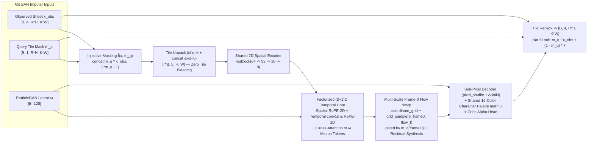

# Sprite-Sheet Animation Generation with MisGAN: Research & Demo Plan

- **Branch / Worktree:** `research/sprite-sheet-animation` (`worktrees/sprite-sheet-animation`, branched off `origin/develop` @ `5f368a37`)
- **Goal:** Generate complete pixel-art sprite animations given **Frame 0** of a sprite — and **"sometimes not even that"** (zero-frame unconditional generation, keyframe in-betweening, or partial-sheet completion) — trained via **MisGAN** (*Learning from Incomplete Data with Generative Adversarial Networks*, Li et al., ICLR 2019) inside HyperGAN 2.0 (`hypergan-model/1` + HNDL 0.10 + ParticleGAN).

---

## 1. Why MisGAN Is the Right Formulation for Sprite Sheets

Sprite animation generation has two coupled missing-data problems—one at **inference time** and one at **dataset curation time**:

1. **Variable Conditioning at Inference ("First Frame, or Sometimes Not Even That"):**
   Representing a character's animation clip (or multi-action sheet) as a canonical $R \times K$ grid of $T = R \cdot K$ tiles $x \in [-1, 1]^{C \times (R H) \times (K W)}$ paired with a tile-structured binary mask $m \in \{0, 1\}^{1 \times (R H) \times (K W)}$ unifies every generation mode under a single MisGAN imputer $G_i(x_{\text{obs}}, m_q, \omega)$:
   - **First-Frame-to-Animation:** $\bar{m}_q = [1, 0, \dots, 0]$. Tile 0 is hard-preserved via $\hat{x} = m_q \odot x + (1 - m_q) \odot \tilde{G}_i(\tilde{f}(x, m_q), \omega)$, while the learned ParticleGAN latent particle $\omega$ drives sharp, multi-modal motion variations across tiles $1 \dots T-1$.
   - **"Sometimes Not Even That" (Unconditional):** $\bar{m}_q = [0, 0, \dots, 0]$. Either sample the Stage-1 complete-sheet generator $G_x(z)$ directly, or pass $m_q = \mathbf{0}$ into $G_i(\mathbf{0}, \mathbf{0}, \omega)$, synthesizing a brand-new character *and* its full animation sheet from scratch.
   - **Bonus Modes Included for Free:** Keyframe in-betweening (e.g., $\bar{m}_q = [1, 0, 0, 0, 1, 0, 0, 0]$) and cross-action sheet completion (observe an `Idle` row $\to$ impute `Walk` and `Attack` rows).

2. **Learning Directly From Incomplete / Ragged Wild Sprite Datasets:**
   Real open-source sprite assets rarely share uniform frame counts or complete action sets:
   - Some packs provide `8` walk frames; others provide only `4` idle + `4` run frames and omit `attack`.
   - *Battle for Wesnoth* units have `1–6` standing frames, `3–7` attack frames, and `1–2` defend frames.
   - Large static pixel-art corpora (`azyg0s/pixelart-172k`) provide **172,000+ Frame-0-only sprites** ($\bar{m}_{\text{obs}} = [1, 0, \dots, 0]$) with zero animation frames.
   - Standard video/sheet models must discard incomplete characters or distort timing via frame duplication. **MisGAN learns directly from `(x_obs, m_obs)` pairs**: its complete-data generator $G_x(z)$ learns the full $T$-frame joint distribution even when individual training sheets are partially observed.

### 1.1 Mathematical Formulation Adapted to Tile-Structured Sprite Sheets

Let $\bar{m} \in \{0, 1\}^{R \times K}$ be the tile-level observation mask, upsampled via nearest-neighbor Kronecker product $m = \bar{m} \otimes \mathbf{1}_{H \times W}$ to full sheet resolution.

- **Injective Bounded Masking Operator $\tilde{f}(x, m)$:**
  In original MisGAN, $f_\tau(x, m) = m \odot x + (1 - m)\tau$ can collide with legitimate sprite pixels if $\tau \in [-1, 1]$ (e.g., black outlines at $-1$, mid-gray at $0$, white highlights at $+1$), while $\tau \notin [-1, 1]$ distorts critic Lipschitz gradient-penalty scaling. Instead, we define:
  $$\tilde{f}(x, m) = \operatorname{concat}\!\big(m \odot x,\; 2m - 1\big) \in [-1, 1]^{(C+1) \times (R H) \times (K W)}$$
  This mapping is **strictly injective** over all $x \in [-1, 1]^C$, keeps every coordinate bounded in $[-1, 1]$, and zeroes gradients to unobserved tiles ($\frac{\partial (m \odot x)}{\partial x} = m$).

- **Stage 1 — Complete Sprite-Sheet Generator $(G_x, D_x)$ (+ Optional Tile-Mask Model $(G_m, D_m)$):**
  - $G_x(z_x)$ outputs complete unmasked sprite sheets $\tilde{x} \in [-1, 1]^{C \times (R H) \times (K W)}$ from a ParticleGAN latent table $z_x$.
  - When missingness is MCAR or stratified by known source distribution, $\tilde{m}$ is drawn from the empirical dataset tile-mask buffer. When missingness correlates strongly with character sub-type (MAR/MNAR, e.g., mixing 1-frame static monsters with 8-frame humanoids), a lightweight MLP tile-mask generator $G_m(z_m) \in [0, 1]^{R \times K}$ (temperature-annealed sigmoid $\sigma(\ell / \lambda)$) is coupled via $\min_{G_m}\max_{D_m} \mathcal{L}_m(D_m, G_m) + \alpha \mathcal{L}_x(D_x, G_x, G_m)$ ($\alpha = 0.2$).
  - $D_x$ scores $\tilde{f}(x_{\text{real}}, m_{\text{real}})$ vs. $\tilde{f}(G_x(z_x), \tilde{m})$.

- **Stage 2 — Multi-Modal Sprite Imputer $(G_i, D_i)$:**
  - During training, for each real item $(x_{\text{real}}, m_{\text{real}})$, sample a **query sub-mask** $m_q = m_{\text{real}} \odot b$ ($m_q \le m_{\text{real}}$, so $x_{\text{real}} \odot m_q$ never reads an unobserved pixel!), where $b$ is drawn from our target inference mixture:
    - **`60%` First-Frame Only:** $\bar{b} = [1, 0, \dots, 0]$
    - **`20%` Unconditional ("Not Even That"):** $\bar{b} = [0, 0, \dots, 0]$
    - **`10%` Keyframes / Partial Action Row:** $\bar{b} \in \{\text{frames } \{0, 4\}, \text{row } 0\}$
    - **`10%` Empirical Completion:** $\bar{b} = \mathbf{1}$ ($m_q = m_{\text{real}}$)
  - The imputer produces a complete sprite sheet with exact hard-locking on observed tiles:
    $$\hat{x}_{\text{imp}} = m_q \odot x_{\text{real}} + (1 - m_q) \odot \tilde{G}_i\!\big(\tilde{f}(x_{\text{real}}, m_q),\; \omega\big)$$
    where $\omega$ is drawn from Stage 2's ParticleGAN latent table.
  - $D_i$ discriminates **complete reference sheets** ($G_x(z_x)$ from frozen Stage-1 $G_x$, mixed with complete real sheets where $m_{\text{real}} = \mathbf{1}$) against **imputed complete sheets** $\hat{x}_{\text{imp}}$.
  - *Why adversarial MisGAN imputation beats L1 pixel regression on future frames:* Given only Frame 0, future motion is inherently **multi-modal** (different attack arcs, stride phases, idle breaths). Pixel L1 on frames $1 \dots T-1$ averages distinct motions into blurry ghosts and collapses $\omega$; $D_i$ enforces sharp pixel-art frames that stay identity- and palette-consistent with the hard-locked Frame 0.

---

## 2. Architecture Comparison: Conv3D vs. NeRF / Splatting vs. Tile-Factorized `(2+1)D`

Recent literature—including *Sprite Sheet Diffusion* (Hsieh et al., `arXiv:2412.03685`), *Neural Controlled Directional Frame Generation for Sprite Animation* (Alonso et al., `arXiv:2610.27253`), and *Gaussian Billboards* (`arXiv:2412.03430`)—highlights sharp domain constraints of pixel-art sprites: **hard binary alpha**, **1px dark outlines**, **small discrete color palettes (8–16 colors)**, and **large inter-frame pixel jumps (8–24px/frame at 6–12 FPS)**.

| Architecture Candidate | How It Works | Pros | Cons / Failure Modes on Sprites | Verdict |
| :--- | :--- | :--- | :--- | :--- |
| **1. Pure `Conv3D`** (`[B, C, T, H, W]`) | $3 \times 3 \times 3$ spatiotemporal convolutions & transposed convolutions across $(T, H, W)$. | Detects local $\pm 1\text{px}$ inter-frame flicker and static copying naturally; translation-equivariant. | 1) Small temporal-spatial receptive field blurs 8–24px snappy limb/weapon jumps. 2) $3\times$ parameter/FLOP cost vs. factorized `(2+1)D`. 3) Not native in HNDL 0.10 (`conv`/`conv1d` exist, not `conv3d`). | **Reject as primary**; replace with strictly stronger factorized `(2+1)D` (`2D spatial + 1D conv1d / temporal RoPE`). |
| **2A. 3D NeRF / Dynamic 3DGS Projected** | Predict 3D Gaussians $\{\mu_k \in \mathbb{R}^3, \Sigma_k, c_k, \alpha_k\}$ + SE(3) motion $\Delta \mu_k(t)$ and orthographically splat to $32\times 32$ / $64\times 64$. | Strong multi-view 3D turntable consistency when trained on multi-camera 3D renders. | 1) 2D sprites use cheated 2.5D perspectives, non-rigid redraws, and **topological birth/death** (slash arcs, projectiles, dust puffs absent in Frame 0). 2) Collapses to flat $z \approx 0$ plane without multi-view supervision. 3) Gaussian falloff produces blurry anti-aliased fringes that clash with crisp pixel art and MisGAN's exact Frame-0 lock. | **Reject for 2D wild sprites** (only useful for synthetic 3D-turntable sub-tasks). |
| **2B. 2D Gaussian Part-Splats (`2DGS` Latent Bottleneck)** | Decompose Frame 0 into $K \approx 64$ 2D feature splats $(\mu_k(t), \Sigma_k(t), \alpha_k(t))$ rasterized at $16\times 16$ / $32\times 32$ before a pixel-art decoder. | Handles 20px part jumps effortlessly; interpretable part trajectories; dynamic $\alpha_k(t)$ allows VFX splats to appear/vanish. | Direct RGB splatting still blurs 1px outlines; requires a downstream sub-pixel + palette decoder anyway, and needs a custom PyTorch `nn.Module` / HNDL operator. | **Keep as Phase-2 Ablation** (latent motion bottleneck vs. `grid_sample` flow warp). |
| **3. Naive 2D Sheet CNN/ViT** (`[B, C, R*H, K*W]`) | Treat tiled PNG sheet as a single flat 2D image with standard 2D `conv` / `deconv`. | Zero-friction compatibility with `ImageFolder`, `previews.py`, `SampleDiversity`, and `InceptionFID`. | Standard $3\times 3$ / $4\times 4$ convolutions **bleed across adjacent tile borders** (Frame 0's right edge leaks into Frame 1's left edge). | **Reject unfactorized convolutions**, **KEEP the external 2D sheet tensor contract!** |
| **4. Tile-Factorized `(2+1)D` Flow-Warp + Shared Palette** *(Recommended)* | External `[B, C, R*H, K*W]` 2D sheet; unpacks internally via HNDL `chunk`+`concat(axis=0)` to `[T*B, C, H, W]` for 2D spatial ops, `[HW*B, T, D]` for temporal `conv1d` + `RoPE` attention, Frame-0 `grid_sample` warp, and shared 16-color bilinear palette head. | 1) **Zero cross-tile bleeding**. 2) **100% native HNDL 0.10**. 3) Crisp transport via `grid_sample` + crisp discrete colors via shared character palette. 4) Full compatibility with HyperGAN previews, checkpoints, and evaluators. | Slightly longer `.hndl` graph due to explicit tile unpack/repack (already proven in `transgan-generator-128.hndl`). | **Primary Architecture for Demo v1.** |

### 2.1 Recommended Network Topology (Pure HNDL 0.10)

### 2.2 Critic Topology ($D_x$ & $D_i$) — Incorporating `qa-2026-10-30.md` Lessons

Per `reports/qa-2026-10-30.md` (Finding P3), **we explicitly avoid `[CLS]`-token pure-transformer critics**, which can collapse into a constant `[CLS] -> [CLS]` self-attention sink under gradient penalties, and we always declare `defaults = "particlegan"`.

Both $D_x$ and $D_i$ use a **single multi-head HNDL critic network** (matching ParticleGAN's single-critic contract) combining three heads summed with variance-preserving weights:
1. **Per-Frame Multiscale Spatial Head (`[T*B, C, H, W]`):** Unpacks tiles and applies `diff_augment("translation,cutout")` + convolutional `resblock` downsampling stages + `global_avg_pool` (plus frozen `torchvision_resnet18` multiscale features on alpha-composited RGB frames).
2. **Cross-Frame Identity Alignment Head:** Compares frame-$t$ pooled embeddings against frame-$0$'s embedding (`mul` / inner-product + `sub` L1 difference across $t = 0 \dots T-1$), immediately penalizing character/palette drift away from Frame 0.
3. **Explicit Temporal-Difference Motion Head ($\Delta_t = f_{t+1} - f_t$):** Applies HNDL `sub` between consecutive unpacked frame feature maps and runs 1D temporal `conv1d` across $t$ followed by `mean` pooling. **This directly prevents the "copy Frame 0 eight times" static collapse** while penalizing erratic high-frequency flicker.

---

## 3. HyperGAN 2.0 Integration Audit & Surgical Enablers

Auditing `origin/develop` (`5f368a37`) revealed that `hypergan-model/1` and HNDL 0.10 already provide ~95% of what Sprite-Sheet MisGAN needs, with **three small, clean engineering items** to address in this worktree:

1. **Enabler E1 — Honor `real` and `fake` Bindings on Primary `[[losses]]` Adversarial Term (`src/hypergan/objective_program.py:134`):**
   - `src/hypergan/model_file.py:485-488` *already* parses and binds custom `real = "..."` and `fake = "..."` on the primary adversarial loss into `recipe["adversarial"]`.
   - However, `compile_legacy_program` in `src/hypergan/objective_program.py:134` currently calls `_legacy_phases()` (hardcoding `"batch.real"` and `"generated"`) instead of reading `config["adversarial"].get("real", "batch.real")` and `config["adversarial"].get("fake", "generated")`.
   - **Why this matters for MisGAN:** Fixing those 2 lines (with unit tests) lets `networks.generator` output the **clean, unmasked complete sprite sheet** $G_x(z)$ (so `hypergan sample`, `hypergan export`, Web Observatory previews, and `SampleDiversity` all see complete sheets!) while `[[losses]]` scores `real = "masked_real"` vs. `fake = "masked_fake"` in Stage 1, and `real = "gx_complete"` vs. `fake = "generator"` in Stage 2—**all under `defaults = "particlegan"`**!

2. **Enabler E2 — Two-Stage ParticleGAN Execution (Matching Li et al., ICLR 2019 Sec. 3.2):**
   - `src/hypergan/training.py:308` currently requires one critic network when `defaults = "particlegan"` is active.
   - Li et al. (2019) explicitly show that **Two-Stage MisGAN**—training Stage 1 $(G_x, D_x)$ on incomplete data, freezing $G_x$, and training Stage 2 $(G_i, D_i)$ against frozen $G_x$—achieves imputation quality equal to or better than joint 6-network training while cutting per-run VRAM in half and isolating Stage-1 vs. Stage-2 diagnostics.
   - *(Optional Phase-2 engine extension)*: Allow `ModuleDict` multi-critic wrapping in `training.py:308` if single-run joint $(G_x, D_x, G_m, D_m, G_i, D_i)$ training is desired later.

3. **Enabler E3 — Native 4-Channel Premultiplied RGBA Support in `image_grids.py` & `previews.py` (~15 lines):**
   - Pixel-art sprites almost universally contain **both** `1px` black `(0,0,0)` outlines and white `(255,255,255)` specular highlights. Compositing onto black destroys outlines; compositing onto white destroys highlights.
   - Extending channel validation in `src/hypergan/previews.py:97` and `src/hypergan/image_grids.py:22,37,68` from `(1, 3)` to `(1, 3, 4)` (PNG `IHDR` color type `6` = 8-bit RGBA) enables native transparent RGBA sprite sheets `(R*α, G*α, B*α, α)` end-to-end in training, Web Observatory previews, and exported PNGs.

---

## 4. Datasets We Can Learn From (Curated & Tiered for MisGAN)

Because MisGAN natively ingests heterogeneous observation masks $m_{\text{obs}}$, we can combine **complete canonical sheets**, **partially populated wild indie sprite sheets**, and **single-frame static pixel-art corpora** into one unified canonical layout:
- **Demo v1 Canonical Sheet Geometry:**
  - **Fast Iteration Profile (`32×32` per frame):** $2 \times 4 = 8$-frame single-action sheet (`64×128` RGBA) **or** $4 \times 4 = 16$-frame multi-action sheet (`128×128` RGBA: Row 0 = `Idle` 4f, Row 1 = `Walk/Run` 4f, Row 2 = `Attack/Slash` 4f, Row 3 = `Hurt/Cast` 4f).
  - **High-Detail Profile (`64×64` per frame):** $2 \times 4 = 8$-frame sheet (`128×256` RGBA).

| Tier | Dataset Source | License | Scale & Native Resolution | Typical Missingness Mask $\bar{m}_{\text{obs}}$ | Role in MisGAN Pipeline |
| :---: | :--- | :--- | :--- | :--- | :--- |
| **Tier 1** *(Controlled Oracle)* | **1. Reed Sprites + Procedural Universal LPC Generator** (`Universal-LPC-Spritesheet-Character-Generator`) | `GPL-3.0` / `CC-BY-SA-3.0` | `1,296` (Reed) up to **`15,000–25,000`** procedurally layered characters (`64×64`, nearest-downsampled to `32×32` for fast profile); `Idle`, `Walk`, `Slash`, `Spellcast`, `Hurt` across 4 views. | **100% Complete** ($\bar{m}_{\text{obs}} = \mathbf{1}$); lets us impose **synthetic missingness** (e.g., drop 50% of tiles/rows) and score against exact held-out ground truth! | **Phase-1 Benchmark & Quantitative Proof** that MisGAN recovers complete animations from incomplete sheets + Frame-0 / zero-frame queries. |
| **Tier 2** *(Wild Open Animated Sprites)* | **2. CC0 Indie Pixel Packs** (`0x72 16x16 DungeonTileset II`, `Kenney Pixel Platformer` via `shorepine/kenney`, OGA CC0 Monsters/Heroes) | **`CC0-1.0`** *(Public Domain)* | `~500–1,500` diverse non-LPC creatures, slimes, skeletons, knights, platformer characters (`16×16`–`32×32`, padded/2× integer-scaled to `32×32`). | **Partially Observed Rows/Frames** (typically `4f Idle` + `4f Run`, `Attack`/`Hurt` rows missing $\to$ $m_{\text{obs}} = 50\%$). | Breaks humanoid LPC bias; tests MisGAN cross-action completion on real incomplete CC0 game assets. |
| **Tier 2** *(Wild Rich Fantasy Motion)* | **3. The Battle for Wesnoth Units** (`github.com/wesnoth/wesnoth`, `data/core/images/units/` + WML `.cfg` parser) | `GPL-2.0+` | `~350+` distinct units (`~2,000+` multi-frame clips: dragons, undead, cavalry, dwarves, elves, wolves; `54×54`–`72×72` centered into `64×64`). | **Ragged Frame Counts** (`1–6f` standing, `3–7f` attack, `1–2f` defend $\to$ trailing tiles masked $m_{\text{obs}} = 0$). | High-craft hand-drawn pixel motion (wing flaps, slash smears, magic VFX) with natural ragged missingness. |
| **Tier 2** *(HF Pre-Sliced Clips)* | **4. HuggingFace Sprite Animation Sets** (`pawkanarek/spraix_1024`, `carlosuperb/lpc-action-pixel-art-diffusion`) | `GPL-3.0` / `CC-BY-SA` | `~1,000–5,000` pre-sliced sequential animation strips with action/text metadata. | `4–9` frames observed per action. | Ready-to-load pre-sliced frame sequences with action tags. |
| **Tier 3** *(Frame-0-Only Scale-Up)* | **5. Static Pixel-Art Character Subset** (`azyg0s/pixelart-172k` / `unstonio/pixelgpt-24x24-20k`) | Check per-subset HF card (research) | Curated `10,000–20,000` single-frame character/monster sprites (`24×24`–`64×64`). | **Frame-0 Only!** ($\bar{m}_{\text{obs}} = [1, 0, \dots, 0]$, `6.25%–12.5%` observed). | **MisGAN Semi-Supervised Superpower:** expands palette & character appearance vocabulary $10\times$ without requiring ground-truth animation frames. |
| **Tier 3** *(CC0 Synthetic 3D $\to$ Pixel Bridge)* | **6. Quaternius CC0 Rigged 3D Monsters & Characters** (`quaternius.com` `.gltf`/`.blend` $\to$ headless Blender orthographic pixel shader) | **`CC0-1.0`** *(Public Domain)* | `~150+` rigged monsters/animals/mechs $\times$ 4 angles $\times$ palette swaps = **`10,000+`** clean RGBA clips (`32×32` & `64×64`). | 100% Complete + optional ground-truth optical flow & depth. | 100% permissive CC0 commercial-safe non-humanoid corpus; ideal testbed if we run the Phase-2 `2DGS` splat ablation. |

> **Dataset Hygiene Rule:** Following HyperGAN's `ImageFolder` / `ColorizationData` contract, no network downloads occur inside training. A deterministic offline builder script (`scripts/prepare_sprite_sheets.py`) slices/normalizes raw sources into SHA256-manifested canonical RGBA PNG sheets + a sidecar `masks.jsonl` recording each sheet's exact observed tile bitmask $\bar{m}_{\text{obs}}$, character ID (for strict character-disjoint train/val splits!), and action label.

---

## 5. Metrics-First Evaluation & Gate Criteria

Per repository rules (**use metrics over viewing images when possible**; **never run multi-seed duplicate experiments**), every stage is gated on deterministic quantitative evaluators plugged into `[evaluations.<id>]` on `cuda:1` while `cuda:0` trains (using our `2× NVIDIA RTX A6000` setup):

1. **`eval/frame0_lock_mae` (Target: `< 1e-6`):**
   Mean absolute error on observed query tiles $\|m_q \odot (\hat{x} - x)\|_1 / \|m_q\|_1$. Verifies exact Frame-0 preservation by construction.
2. **`eval/motion_energy_ratio` (Target: `0.75 – 1.25`):**
   Ratio of mean inter-frame foreground L1 difference $\frac{1}{T-1}\sum_{t=0}^{T-2}\|\hat{x}_{t+1} - \hat{x}_t\|_1$ on imputed animations vs. held-out real animations.
   - `ratio < 0.25` diagnoses **static Frame-0 copy collapse**.
   - `ratio > 1.60` diagnoses **temporal flicker / noise instability**.
3. **`eval/identity_palette_l1` (Target: `< 0.12`):**
   Foreground RGB 64-bin color-histogram L1 divergence between Tile 0 and imputed Tiles $1 \dots T-1$ (over pixels with $\alpha > 0$). Directly measures whether the character's colors drift across the animation.
4. **`eval/alpha_crispness` (Target: `> 0.92`):**
   Fraction of predicted alpha channel values satisfying $|\alpha| > 0.85$ (near binary transparent `-1` or opaque `+1`). Diagnoses blurry anti-aliased ghosting.
5. **`eval/conditional_omega_diversity` (Target: `> 0.15` foreground RMS across $K=8$ particles):**
   Pairwise RMS spread (`DiversityMoments`) across $K = 8$ distinct ParticleGAN latent draws $\omega_1 \dots \omega_8$ conditioned on the **exact same** Frame 0. Proves the imputer uses $\omega$ for multi-modal motion rather than collapsing to a deterministic map.
6. **`eval/uncond_sheet_fid` & `eval/imputed_frame_fid` (`InceptionFID` on composited RGB):**
   Distributional fidelity of both zero-frame unconditional sheets ($m_q = \mathbf{0}$) and first-frame-imputed sheets ($m_q = \mathbb{1}_{\text{tile } 0}$) against held-out character-disjoint test sheets.
7. **`eval/oracle_best_of_8_l1` (Tier-1 Controlled Missingness Benchmark):**
   On held-out complete test sheets where 50% of training tiles were artificially masked during Stage-1/Stage-2 training, best-of-$8$ ($\min_{k \in 1..8}$) foreground L1 & ResNet-18 perceptual distance against the true unseen frames $1 \dots T-1$.

---

## 6. Phased Demo Implementation Plan

### Phase 0 — Surgical HyperGAN Enablers & Unit Tests (0.5 day)
- Fix `src/hypergan/objective_program.py:134` so `compile_legacy_program` respects `config["adversarial"].get("real", "batch.real")` and `config["adversarial"].get("fake", "generated")` under `defaults = "particlegan"`.
- Extend `src/hypergan/image_grids.py` and `src/hypergan/previews.py` to support 4-channel RGBA (`channels in (1, 3, 4)`, PNG color type `6`).
- Add fast CPU unit tests verifying custom `real`/`fake` gradient routing and 4-channel RGBA PNG round-trip encoding/inspection.

### Phase 1 — Canonical Dataset Builder & `SpriteSheetMisGANDataset` (1 day)
- Implement `scripts/prepare_sprite_sheets.py` + `SpriteSheetMisGANDataset` yielding `{"real": sheet_rgba, "obs_mask": m_obs, "fake_mask": m_emp, "query_mask": m_query}` in deterministic SHA256-verified format.
- Start with **Tier 1 (LPC/Reed `32×32` $4\times 4$ `128×128` 16-tile multi-action sheets + controlled 40% missing-row/frame masking)** + **Tier 2 (`0x72` & `Kenney` CC0 packs)** so we have both exact oracle holdout metrics and genuine wild incomplete sheets from day one.

### Phase 2 — Stage-1 & Stage-2 Declarative HNDL MisGAN Training on `2× RTX A6000` (1.5 days)
- Author declarative `hypergan-model/1` configs and `.hndl` networks:
  - `examples/sprites/misgan-stage1-complete-128.toml` ($G_x$ complete sheet generator + injective masked critic $D_x$, `defaults = "particlegan"`).
  - `examples/sprites/misgan-stage2-imputer-128.toml` (frozen $G_x$ + flow-warped shared-palette imputer $G_i$ + spatiotemporal difference critic $D_i$, trained on the `60% Frame-0 / 20% Zero-Frame / 10% Keyframe / 10% Empirical` mask mixture).
- Implement `sprite_metrics.py` (`Frame0LockMAE`, `MotionEnergyRatio`, `IdentityPaletteDivergence`, `AlphaCrispness`, `ConditionalOmegaDiversity`) wired into `[evaluations.*]` on `cuda:1`.
- Train Stage 1 $\to$ export frozen $G_x$ $\to$ train Stage 2 on `cuda:0`, tracking live telemetry and metric gates.

### Phase 3 — Interactive Sprite-Sheet Demo CLI & Web Preview (1 day)
- Export standalone Stage-2 imputer bundle (`hypergan export`).
- Build a lightweight demo script / local endpoint (`scripts/demo_sprite_animator.py`) supporting three instant workflows from one checkpoint:
  1. **`--first-frame hero.png` (`--variations 4`):** Takes a single static sprite PNG and outputs 4 distinct animated sprite sheets + animated `.gif` / `.webp` loops (varying $\omega_1 \dots \omega_4$).
  2. **`--unconditional` (`--count 8`):** "Not even a first frame" — passes $m_q = \mathbf{0}$ to generate brand-new animated characters and their full sheets from scratch.
  3. **`--keyframes frame0.png:0 frame4.png:4`:** Imputes all intermediate frames cleanly.

### Phase 4 — Scale-Up & Optional Ablations (Follow-Up)
- Add **Tier 2 Wesnoth (`64×64` tiles, `128×256` sheets)** + **Tier 3 (`azyg0s/pixelart-172k` Frame-0-only static sprites + coupled tile-mask $G_m$)**.
- Run single head-to-head metric ablation comparing **HNDL `grid_sample` dense flow warp** vs. **2D Gaussian Part-Splat (`2DGS`) latent motion bottleneck** on large-displacement weapon/monster attacks (`eval/motion_energy_ratio`, `eval/alpha_crispness`, `eval/imputed_frame_fid`).
