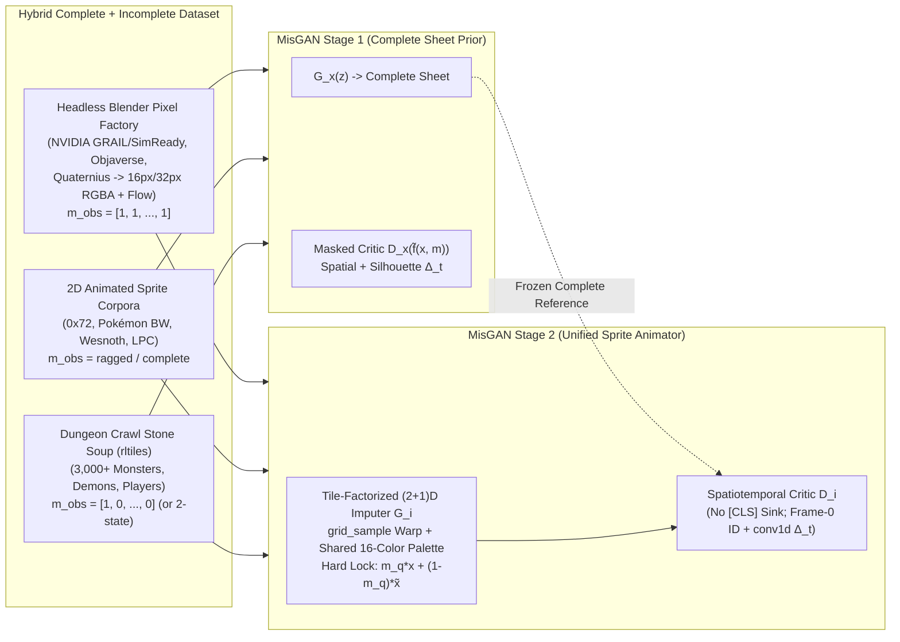

# Sprite-Sheet Animation Generation with MisGAN, Blender & DCSS: Research & Demo Plan

- **Branch / Worktree:** `research/sprite-sheet-animation` (`worktrees/sprite-sheet-animation`, branched off `origin/develop` @ `5f368a37`)
- **Goal:** Generate complete pixel-art sprite animations given **Frame 0** of a sprite — including animating **static *Dungeon Crawl Stone Soup* (DCSS) sprites** and **"sometimes not even that"** (zero-frame unconditional generation or keyframe in-betweening) — using **MisGAN** (Li et al., ICLR 2019), a **headless Blender 3D-to-Pixel-Art synthetic motion pipeline** (including NVIDIA's open 3D/4D synthetic datasets), and a **low-res-first progressive scaling ladder (`16×16` $\to$ `32×32` native DCSS $\to$ `64×64`)** inside HyperGAN 2.0 (`hypergan-model/1` + HNDL 0.10 + ParticleGAN).

---

## 1. Core Thesis: MisGAN Bridges Static DCSS Sprites + Animated Blender / 2D Sheets

*Dungeon Crawl Stone Soup* (`crawl/crawl` `rltiles`) contains **3,000+ iconic `32×32` roguelike monster, demon, and player sprites**, almost all of which are **static single-frame tiles** ($\bar{m}_{\text{obs}} = [1, 0, \dots, 0]$). Meanwhile, 3D animated assets rendered through a pixel-art Blender pipeline (plus wild 2D animated sprite datasets) give unlimited **complete multi-frame motion sequences** ($\bar{m}_{\text{obs}} = [1, 1, \dots, 1]$ or partial masks).

**MisGAN** (*Learning from Incomplete Data with Generative Adversarial Networks*, ICLR 2019) connects these two worlds cleanly:

1. **Unified Inference ("First Frame, or Sometimes Not Even That"):**
   Packing $T = R \cdot K$ frames into a canonical 2D RGBA sprite sheet $x \in [-1, 1]^{4 \times (R H) \times (K W)}$ with a tile-level binary mask $\bar{m}_q \in \{0, 1\}^{R \times K}$ (upsampled via $m_q = \bar{m}_q \otimes \mathbf{1}_{H \times W}$) turns every demo mode into an imputation query on $G_i(x_{\text{obs}}, m_q, \omega)$:
   - **Animate Any Static DCSS Sprite (First-Frame Mode):** $\bar{m}_q = [1, 0, \dots, 0]$. Output $\hat{x} = m_q \odot x + (1 - m_q) \odot \tilde{G}_i(\tilde{f}(x, m_q), \omega)$ locks Tile 0 **bit-for-bit** to the input DCSS sprite while ParticleGAN latent particle $\omega$ generates diverse multi-modal idle/walk/attack animations across tiles $1 \dots T-1$.
   - **"Sometimes Not Even That" (Zero-Frame Unconditional):** $\bar{m}_q = [0, \dots, 0]$ (or sampling Stage-1 $G_x(z)$ directly) invents a brand-new roguelike monster/character *and* its full animation sheet purely from a latent particle.
   - **Keyframe In-Betweening & Multi-Row Action Completion:** Set $\bar{m}_q = [1, 0, 0, 0, 1, 0, 0, 0]$ (or observe a 2-variant DCSS monster like active/resting poses!) and impute the full animation cycle.

2. **Training Directly on Static (`m = [1,0,...]`), Ragged, and Complete (`m = [1,1,...]`) Sheets Together:**
   - **Injective Bounded Masking Operator $\tilde{f}(x, m)$:**
     $$\tilde{f}(x, m) = \operatorname{concat}\!\big(m \odot x,\; 2m - 1\big) \in [-1, 1]^{5 \times (R H) \times (K W)}$$
     Strictly injective over $[-1, 1]^4$, preserves $[-1, 1]$ Lipschitz scaling for critic gradient penalties, and zeroes gradients on unobserved tiles.
   - **Preventing Domain-Mask Shortcutting Between Static DCSS (`m = [1,0,...]`) and Complete Blender/2D Sheets (`m = [1,1,...]`):**
     Because DCSS tiles are predominantly 1-frame while Blender sheets are $T$-frame (MAR/MNAR missingness), a naive independent mask $\tilde{m}$ would let $D_x$ detect a shortcut ("DCSS texture never appears with all 8 tiles unmasked"). We prevent this via three mechanisms:
     1. **Coupled Tile-Mask MisGAN / Overlapping Mask Dropout:** Apply synthetic Frame-0-only masking ($\bar{m} = [1, 0, \dots, 0]$) to `30%` of complete animated sheets so single-frame masks overlap both domains, optionally paired with MisGAN's coupled $T$-bit tile-mask generator $G_m(z_m)$ ($\mathcal{L}_m + \alpha \mathcal{L}_x$, $\alpha = 0.2$).
     2. **DCSS-Matched Blender Pixel Shader:** Match Blender's orthographic camera angle (3/4 roguelike elevation), `1px` dark outline, hard binary alpha, and DCSS color-palette quantization so synthetic renders share low-level pixel statistics with `rltiles`.
     3. **Silhouette / Alpha Motion Critic Branch:** Include a texture-invariant alpha-silhouette temporal-difference branch in $D_x$ and $D_i$ so motion dynamics transfer cleanly across textures.

---

## 2. Progressive Low-Res-First Scaling Ladder (`16px` $\to$ `32px` DCSS $\to$ `64px`)

Starting at low resolution lets us validate MisGAN dynamics, motion transfer onto DCSS sprites, and metric gates in **minutes per run** on `2× RTX A6000`, while scaling cleanly via `extends` and one additional HNDL `pixel_shuffle(2)` + `resblock` stage per octave:

| Scale Stage | Per-Frame Tile | Canonical Sheet Layout (`2×4` = 8f / `4×4` = 16f) | Speed & Purpose | Native Datasets at This Scale |
| :--- | :---: | :---: | :--- | :--- |
| **Scale 0 (Start Here)** | **`16×16`** | **`32×64`** (8f single clip) or **`64×64`** (16f multi-action) | `>500 sheets/s`; sub-15-min ablations on `cuda:0`. Proves MisGAN Frame-0 + zero-frame + DCSS motion transfer fast. | Native `0x72 DungeonTileset II` (`16×16`), `Kenney` (`16×16`), 2×-downsampled **DCSS `rltiles`**, `16×16` **Blender** renders, downsampled Pokémon/Wesnoth. |
| **Scale 1 (Native DCSS)** | **`32×32`** | **`64×128`** (8f) or **`128×128`** (16f: `Idle/Walk/Attack/Hit`) | **1:1 Native DCSS `rltiles` resolution** (zero resampling!). Adds 1 `pixel_shuffle(2)` + `resblock` stage to Scale 0. | **1:1 DCSS `rltiles` (`32×32`)**, `32×32` **Blender** renders, LPC (`2×` downsampled), Pokémon Gen-5 sprites, `spraix_1024`. |
| **Scale 2 (High Detail)** | **`64×64`** | **`128×256`** (8f) or **`256×256`** (16f) | Full high-detail sprite sheets; adds 1 more `pixel_shuffle(2)` + `resblock` stage (plus windowed attention as in `transgan-generator-128.hndl`). | Native **LPC (`64×64`)**, **Battle for Wesnoth** (`54–72px`), **Pokémon Gen-5 BW** (`64–96px`), `64×64` **Blender** renders. |

---

## 3. Architecture Comparison (`Conv3D` vs. `NeRF/Splatting` vs. Tile-Factorized `(2+1)D`)

| Architecture Candidate | Strengths | Limitations on Pixel-Art Sprites | Verdict |
| :--- | :--- | :--- | :--- |
| **Pure `Conv3D`** (`[B, C, T, H, W]`) | Local $\pm 1\text{px}$ flicker & static-copy detection. | At 6–10 FPS roguelike frame rates, limbs/weapons jump **4–16px per frame**; $3\times 3\times 3$ kernels blur snappy jumps, cost $3\times$ params vs. `(2+1)D`, and aren't native in HNDL 0.10. | **Skip** in favor of factorized `(2+1)D` + explicit warp. |
| **3D NeRF / Dynamic 3DGS Projected** | True 3D turntable consistency when supervised by multi-view cameras. | 2D sprites (DCSS, Wesnoth, Pokémon) cheat 2.5D perspective, spawn/destroy topology mid-clip (slash arcs, spell bursts, breath fire absent in Frame 0), collapse to $z \approx 0$ on 2D data, and produce blurry anti-aliased Gaussian fringes vs. crisp binary alpha. | **Skip as neural representation** — **USE explicit 3D in Blender offline** to render crisp quantized training sheets instead! |
| **2D Gaussian Part-Splats (`2DGS` Latent Bottleneck)** | Explicit $K \approx 32\text{–}64$ 2D part trajectories $(\mu_k(t), \Sigma_k(t), \alpha_k(t))$ transport body parts across large jumps; dynamic $\alpha_k(t)$ spawns VFX. | Direct RGB splatting blurs `1px` outlines next to MisGAN's exact Frame-0 lock; still needs a pixel-art palette decoder. | **Optional Scale-1/2 Ablation** against HNDL `grid_sample` flow warp. |
| **Tile-Factorized `(2+1)D` Flow-Warp + Shared Palette** *(Recommended)* | External `[B, 4, R*H, K*W]` 2D RGBA sheet; HNDL `chunk`+`concat(axis=0)` unpacks tiles to `[T*B, ...]` (**zero cross-tile convolution bleeding**); combines 2D `resblock`, 1D temporal `conv1d` + `RoPE`, Frame-0 `grid_sample` warp, and a character-shared 16-color bilinear palette head. | Slightly more verbose `.hndl` unpack/repack block (already proven in `transgan-generator-128.hndl`). | **Primary Architecture across Scales 0 $\to$ 1 $\to$ 2 (100% Native HNDL 0.10).** |

> **Note on "3D Projected to Sprites":** Moving the 3D projection step into **offline headless Blender rendering with a crisp roguelike pixel-art shader** captures 100% of the geometric & motion richness of 3D rigs without forcing the runtime neural generator to fight blurry Gaussian anti-aliasing or rigid-topology limits on 2D DCSS sprites!

---

## 4. Blender Synthetic Pixel-Art Pipeline & Dataset Stack

Since fair-use research training removes license bottlenecks, we combine **NVIDIA & open 3D/4D Blender pipelines**, **Dungeon Crawl Stone Soup (`rltiles`)**, and **top 2D animated creature/character datasets**:

### 4.1 Headless Blender Orthographic Roguelike Renderer (`scripts/blender_sprite_renderer.py`)
- **Install / Execution:** Headless Blender 4.x (`blender --background --python scripts/blender_sprite_renderer.py`) running EEVEE-Next / Workbench on our local RTX A6000s (renders thousands of `16×16` and `32×32` 8-frame RGBA sheets per minute!).
- **Roguelike Pixel-Art Shader Recipe (Matched to DCSS `rltiles`):**
  1. **Camera:** Orthographic projection at `~30°–35°` top-down roguelike pitch, rendered across 4 or 8 azimuth angles, auto-framed tightly to character bounding box with 2px margin.
  2. **Crisp Pixel Sampling:** `film_transparent = True`, `filter_size = 0.01` (disables anti-aliased Gaussian pixel filtering for crisp binary alpha), stepped 3-band cel/toon shading + specular highlight dot.
  3. **1px Dark Roguelike Outline & Palette Quantization:** Post-pass 1px exterior/crease dark-outline morphological pass + k-means / LUT quantization onto 12–16 colors (optionally matched to DCSS monster palettes!).
  4. **Snappy Sprite Timing & Ground-Truth Sidecars:** Subsample animation keyframes at `6–8 FPS` (walk, idle, attack, hit, cast) simultaneously at **`16×16`, `32×32`, and `64×64`**, plus optional 2D optical-flow (`Vector` pass) for evaluating our flow-warp module.

### 4.2 Datasets to Ingest

| Category | Source | Format & Scale | Observed Mask $\bar{m}_{\text{obs}}$ | Role |
| :--- | :--- | :--- | :---: | :--- |
| **Target Roguelike Anchor** | **1. Dungeon Crawl Stone Soup (`crawl/crawl` `rltiles` & `crawl/tiles`)** | `~3,000–4,000` native `32×32` RGBA PNGs (`dc-mon.txt`, `dc-demon.txt`, `dc-player.txt`); monsters, demons, uniques, paperdolls. | **`[1, 0, ..., 0]`** *(plus 2-tile masks for resting/active/variant pairs)* | **Primary Demo Target:** teaches exact DCSS pixel aesthetic, creature silhouettes, and palettes; primary testbed for animating static sprites! |
| **NVIDIA 3D / Blender Datasets** | **2A. `nvidia/PhysicalAI-Robotics-Locomanipulation-GRAIL` (`NVlabs/GRAIL`)** **2B. `nvidia/PhysicalAI-SDG-SynHuman`** **2C. `nvidia/simready-assets` (OpenUSD)** **2D. `nv-tlabs/LLaMA-Mesh` / TRELLIS meshes** | Blender-native 4D rigged SMPL-X humanoid loco-manipulation trajectories (`GRAIL`), synthetic human action clips, and OpenUSD 3D assets imported via `bpy.ops.wm.usd_import()` with procedural idle/bob/attack/turntable rigs. | **`[1, 1, ..., 1]`** *(Complete at `16px`, `32px`, `64px`)* | Rich articulated 3D motion trajectories (walk, swing, reach, turn) rendered directly through our DCSS-style Blender pixel shader. *(Confirm if another specific NVIDIA Blender release is also desired!)* |
| **3D Animated Monsters & Fantasy Rigs (Blender)** | **3. Objaverse-XL Animated Subset (`~40k` animated `.glb`/`.blend`) + `Seed3D/Articulation-XL2.0` + Quaternius Animated Monsters** | Thousands of rigged non-humanoid 3D monsters (dragons, spiders, slimes, skeletons, golems, elementals) rendered through `blender_sprite_renderer.py`. | **`[1, 1, ..., 1]`** *(Complete at `16px`, `32px`, `64px`)* | **Crucial non-humanoid 3D motion bridge** matching DCSS's diverse monster anatomy (quadrupeds, flyers, blobs, multi-limbed creatures). |
| **2D Hand-Drawn Animated Creatures** | **4. Pokémon Gen-5 (Black/White / Showdown) Animated Sprites + Battle for Wesnoth (`wesnoth/wesnoth`)** | `~800+` animated creature loops (Pokémon BW) + `~2,000+` fantasy unit clips (Wesnoth: undead, dragons, mages, wolves, dwarves). | **Complete & Ragged** (`2–8` frames per clip) | Authentic 2D pixel-art creature motion (wing flaps, squash-and-stretch, breath/spell VFX, 1px outline preservation) that pure 3D rigs lack. |
| **2D Low-Res Roguelike & Modular Sheets** | **5. `0x72 16x16 DungeonTileset II` + `Kenney` + Universal LPC + `pawkanarek/spraix_1024`** | `~500+` native `16×16` roguelike heroes/monsters (`0x72`) + `10k+` layered `64×64` $\to$ `16/32px` LPC action sheets. | **Partial (`0x72` 4f idle/run) & Complete (`LPC` 8f)** | Native `16×16` pixel-grid anchor for **Scale 0** plus controlled oracle holdout benchmark. |

---

## 5. HyperGAN 2.0 Surgical Enablers (Unchanged, Minimal Footprint)

1. **`src/hypergan/objective_program.py:134` (2-line fix + unit test):** Honor `config["adversarial"].get("real", "batch.real")` and `config["adversarial"].get("fake", "generated")` in `compile_legacy_program` so Stage-1 (`real = "masked_real"`, `fake = "masked_fake"`) and Stage-2 (`real = "gx_complete"`, `fake = "generator"`) run natively under `defaults = "particlegan"` while `networks.generator` outputs clean unmasked complete sheets.
2. **`src/hypergan/image_grids.py` & `src/hypergan/previews.py` (~15 lines + unit test):** Allow 4-channel RGBA (`channels in (1, 3, 4)`, PNG `IHDR` color type `6`) so transparent sprite sheets preserve both `1px` black DCSS outlines and white highlights in Web Observatory previews and PNG exports.
3. **Critic Guardrail (`reports/qa-2026-10-30.md` Finding P3):** No `[CLS]`-token pure-transformer critics; use `defaults = "particlegan"` with a single multi-head HNDL critic combining unpacked per-frame convolutional `resblock`s, Frame-0 identity alignment, and explicit `sub` + `conv1d` temporal differences $\Delta_t = f_{t+1} - f_t$ (plus silhouette $\Delta_t^\alpha$).

---

## 6. Metrics-First Evaluation Suite (`cuda:0` Train / `cuda:1` Eval on `2× RTX A6000`)

Per `AGENTS.md` (**metrics over viewing images when possible**; **never run duplicate multi-seed experiments**):

1. **`eval/frame0_lock_mae` (`< 1e-6`):** Verifies exact pixel preservation of input DCSS / test Frame 0.
2. **`eval/motion_energy_ratio` (`0.75 – 1.25`, split across holdout animated & DCSS-conditioned sets):** Ratio of mean inter-frame foreground L1 displacement $\frac{1}{T-1}\sum_t \|\hat{x}_{t+1} - \hat{x}_t\|_1$ vs. real animated sheets. Immediately catches **"static DCSS Frame-0 copy collapse"** (`ratio < 0.25`) or **"temporal noise flicker"** (`ratio > 1.60`) *specifically on held-out static DCSS test monsters*!
3. **`eval/dcss_identity_palette_l1` (`< 0.12`):** Foreground RGB histogram L1 divergence between input DCSS Frame 0 and imputed Frames $1 \dots T-1$ (verifies monsters don't drift into Blender/LPC colors after Frame 0).
4. **`eval/alpha_crispness` (`> 0.92`):** Fraction of alpha pixels with $|\alpha| > 0.85$ (catches blurry anti-aliased ghosting).
5. **`eval/conditional_omega_diversity` (`> 0.15` foreground RMS across $K=8$ particles $\omega$):** Verifies that one static DCSS monster sprite produces multiple distinct animations across different latent particles $\omega_1 \dots \omega_8$.
6. **`eval/uncond_sheet_fid` & `eval/dcss_imputed_frame_fid`:** `InceptionFID` on composited RGB sheets (zero-frame unconditional mode) and unpacked imputed frames ($t \ge 1$ conditioned on held-out DCSS monsters, scored against real DCSS + animated sprite frame distribution).
7. **`eval/oracle_best_of_8_l1`:** Best-of-8 masked foreground L1 against true unseen frames $1 \dots T-1$ on held-out complete Blender + 2D animated test clips.

---

## 7. Phased Execution Roadmap (Low-Res First $\to$ Scale Up)

- **Phase 0 — Engine Enablers (`0.5 day`):**
  Land the 2-line `objective_program.py` `real`/`fake` fix + 4-channel RGBA PNG preview support + fast CPU unit tests.
- **Phase 1 — Headless Blender Pixel Factory + DCSS `rltiles` Ingestion at Scale 0 (`16×16` tiles, `32×64` 8-frame sheets) (`1 day`):**
  1. Set up portable headless Blender 4.x CLI and `scripts/blender_sprite_renderer.py` (orthographic roguelike camera, 1px dark outline, quantized palette, simultaneous `16×16` & `32×32` output).
  2. Pull **DCSS `rltiles` (`crawl/tiles` / `crawl/crawl`)**, **`0x72 16x16 DungeonTileset II`**, **Pokémon BW / Wesnoth**, and initial **Blenderanimated 3D monsters + NVIDIA `GRAIL`/USD rigs** into `scripts/prepare_sprite_sheets.py` producing SHA256-verified canonical sheets + tile masks.
- **Phase 2 — Scale-0 (`16×16` tile / `32×64` sheet) MisGAN Proof & Iteration (`1 day`):**
  Train declarative HNDL `misgan-stage1-16px.toml` and `misgan-stage2-imputer-16px.toml` on `2× RTX A6000`. Verify all 7 quantitative metric gates—especially `eval/motion_energy_ratio` and `eval/dcss_identity_palette_l1` on held-out DCSS monsters AND unconditional ($m_q = \mathbf{0}$) generation.
- **Phase 3 — Scale-1 (`32×32` Native DCSS Resolution / `64×128` & `128×128` Sheets) + Interactive Demo (`1–1.5 days`):**
  Add one HNDL `pixel_shuffle(2)` + `resblock` octave to hit **1:1 native `32×32` DCSS resolution**, train Stage 1 & Stage 2, export standalone generator bundles, and ship `scripts/demo_sprite_animator.py`:
  - `python scripts/demo_sprite_animator.py --first-frame dcss_sigmund_32.png --variations 4` $\to$ animated `.gif`/`.webp` + `64×128` RGBA sprite sheet
  - `python scripts/demo_sprite_animator.py --unconditional --count 8` $\to$ brand-new animated roguelike monsters from scratch
  - *(Ready to scale to Scale 2 `64×64` tiles via one further octave extension).*
